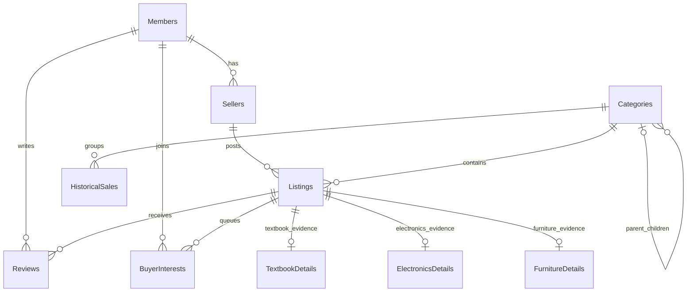

# V0.2 implementation note: simplified Milestone 1

Date: 28 October 2026. Project: UC-B Campus Marketplace with Reviews, Option J, Group 1, EDP 69323, BSCPE 3B.

This note describes the simplified implementation on `feature/milestone-1-prototype`. It continues V0.2. The current revised proposal and cumulative design PDF are published on the repository's `main` branch, under `docs/proposal.pdf` and `docs/design-document.pdf`. Older Word exports are historical copies and may describe the earlier structure.

The planned listing types, condition policies, category tree, waitlist behavior and ten-table data model remain. The implementation reduces the former 23 main Java files to 12 by merging related supporting responsibilities and removing presentation-only artwork and launch helpers. It preserves separate model, service, persistence and UI packages.

The current GUI is further reduced to one screen: listing table, small inline posting form, category dropdown/search controls and a details area. The member selector uses fictional Alex, Bea and Carlo. There are no separate Marketplace/My listings/Recently viewed pages or withdrawal controls in this GUI. `View details` and `Join waitlist` retain a small runtime demonstration of the stack and queue.

Windows editor launch profiles are supplied in `program/Run-Campus-Marketplace.launch` (Eclipse Java Application) and `program/.vscode/launch.json` (Antigravity/VS Code Java debugger). They launch `App` directly with JavaFX on its named module path, using Maven's already resolved libraries. A local ignored settings file enables the same options for inline Run on this computer. The profiles' resolved arguments were checked for equality and their direct Java launch loaded the three seeded listings with a valid database and no startup errors. This configuration adds no Java classes or UI behavior. Actual editor import/extensions and button clicks remain manual verification steps.

## 1. Class hierarchy and runtime polymorphism

```text
Listing (abstract)
  +-- Textbook
  +-- Electronics
  +-- Furniture
```

`Listing` owns ID, seller/category IDs, title, exact decimal price, currency and status. It validates shared values and declares `getType()` and `gradeCondition()`. Each subclass stores its own condition evidence and overrides both methods.

| Type | Condition evidence | Grading order |
|---|---|---|
| Textbook | Missing pages, marking level, damaged cover | Missing pages: POOR; otherwise heavy markings: FAIR; otherwise light markings or damaged cover: GOOD; otherwise LIKE_NEW. |
| Electronics | Power, functional defect, cosmetic damage | No power or functional defect: POOR; otherwise cosmetic damage: GOOD; otherwise LIKE_NEW. |
| Furniture | Stability, structural damage, surface wear | Unstable or structural damage: POOR; otherwise heavy wear: FAIR; light wear: GOOD; otherwise LIKE_NEW. |

Runtime evidence in source: the table's Condition column calls `listing.gradeCondition()` through the shared `Listing` type. Java dispatches to the concrete object's method. The details area also displays the calculated condition. The grading policy stays out of the UI.

The running design loads concrete objects from SQL rows into `List<Listing>`. A type discriminator and its matching detail row determine which constructor is called. Declaring subclasses alone is not the evidence: the shared method call is essential.

## 2. Class responsibilities and single responsibility

Paths below are relative to `program/src/main/java/edu/uc/campusmarket/`.

| File | Responsibility and reason to change |
|---|---|
| `model/Listing.java` | Common item data, value validation and grading contract; changes when shared listing rules change. |
| `model/Textbook.java` | Textbook evidence and grading; changes with textbook condition policy. |
| `model/Electronics.java` | Electronics evidence and grading; changes with electronics condition policy. |
| `model/Furniture.java` | Furniture evidence and grading; changes with furniture condition policy. |
| `model/ConditionGrade.java` | Allowed grade values: LIKE_NEW, GOOD, FAIR and POOR. |
| `model/WearLevel.java` | Allowed marking/surface-wear values: NONE, LIGHT and HEAVY. |
| `model/Member.java` | Member identity and display name; a member can act as buyer and seller. |
| `model/Category.java` | Category identity, name and optional parent reference. |
| `persistence/Database.java` | SQLite connection setup, schema/seed initialization, row mapping and parameterized data operations. It owns persistence changes. |
| `service/MarketplaceService.java` | Coordinates member actions, ownership checks, recursive search and queue/history behavior without JavaFX controls or SQL. |
| `ui/MarketplaceView.java` | One screen's listing table, small inline form, explicit button handlers and details area; delegates policy and persistence. |
| `App.java` | JavaFX lifecycle and creation of the database/service/view; changes with application startup/shutdown. |

For this prototype, `Database` combines the former connection factory and JDBC repository. `MarketplaceService` combines the former category, buyer-interest and recently-viewed services. Snapshot, generic validation, separate seller-data, buyer-entry and artwork helpers are removed; ordinary values/lists and constructors replace them. The fewer classes do not move SQL into controls or grading into the database. A larger future application could separate these responsibilities again.

The screen has one worker executor for JDBC work and returns results through JavaFX Task callbacks. Closing the view shuts down the worker. This small mechanism keeps database activity off the UI thread; it does not implement the later background JSON importer.

The `Search / refresh` button explicitly connects to `refresh()` with `setOnAction`, and `Post listing` connects to `postListing()`. The posting handler reads title, exact decimal price, type, category and one condition observation. That observation becomes actual subtype evidence, rather than a manually selected grade. `Missing pages` represents one missing page in this small form; the underlying model still supports full counts. The model's complete rules and combination tests remain unchanged. After a successful INSERT, `search()` SELECTs All finds and the table displays the saved result. This is the primary live demonstration of a wired GUI control.

Category search validates IDs/parents/cycles, recursively collects the chosen category and descendants, then filters available listings with ordinary loops. The GUI category dropdown replaces the former expandable tree widget; the stored parent/child structure and recursive behavior remain. A leaf has no children, so its call returns without another recursive call. There are no hardcoded depth levels; ordinary Java call-stack limits still apply.

Waitlists rebuild a `Queue<Long>` from durable `joiningOrder` rows, `offer()` buyers at the tail and `poll()` from the head for FIFO display. Each member's recent views use a `Stack<Long>` in a `Map<Long, Stack<Long>>`; unique IDs are pushed to the top, bounded to 20, and popped from a copy for display. The details area shows the waitlist and a preview of up to three recent titles. Recent history is session-only; waitlists survive restart. The backend `myListings()` and owner-only withdrawal methods remain tested, but are not exposed as controls on the reduced screen.

## 3. ER relationships and cardinalities



| Parent | Child/reference | Relationship |
|---|---|---|
| Members | Sellers | One member to zero or many seller profiles; each seller profile belongs to one member. The simple app selects the first profile for a member and seeds one per demo member. |
| Members | Reviews | One member to zero or many reviews; each review identifies one reviewer. |
| Members | BuyerInterests | One member to zero or many interests; each interest identifies one buyer. |
| Sellers | Listings | One seller to zero or many listings; every listing has one seller. |
| Categories | Listings | One category to zero or many listings; every listing has one category. |
| Categories | HistoricalSales | One category to zero or many sales records; every sale has one category. |
| Categories | Categories | Each category has 0..1 parent; a parent has 0..* children. A null parent is a root. This is an intentional self-reference. |
| Listings | Reviews | One listing to zero or many reviews; each review belongs to one listing. |
| Listings | BuyerInterests | One listing to zero or many interests; each interest belongs to one listing. |
| Listings | Each subtype-detail table | One listing to 0..1 row in each individual detail table; exactly one matching detail row across all three for a valid saved listing. |

Subtype `listingId` is both primary key and foreign key. SQL prevents duplicate rows inside a given detail table, but foreign keys alone do not enforce exclusive matching across the three tables. `Database.insertListing()` supplies that repository responsibility: parent and matching subtype are written in one transaction, with rollback on failure. `readListing()` checks the count and discriminator while loading. Each valid listing therefore has one corresponding subtype record through the application's save/load path.

The category SQL check rejects self-parenting, while Java rejects longer cycles and missing parents. `parentId` connects two rows of Categories; it does not create a second category table.

## 4. Schema matching the approved data model

Source of executable DDL: `program/src/main/resources/db/schema.sql`. The same ten approved tables and their constraints are retained.

| Table | Columns and key rules |
|---|---|
| Members | `id` PK; nonblank `name`. |
| Sellers | `id` PK; `memberId` FK; nonblank `displayName` and `sellerKind`. |
| Categories | `id` PK; nullable `parentId` FK to Categories; nonblank `name`; no direct self-parent. |
| Listings | `id` PK; seller/category FKs; type in TEXTBOOK/ELECTRONICS/FURNITURE; nonblank title; positive integer `priceMinor`; three uppercase currency letters; nonblank status. Java limits supported lifecycle states to AVAILABLE/WITHDRAWN. |
| Reviews | `id` PK; listing/reviewer FKs; integer rating 1-5; optional comment. Review entry remains later work. |
| BuyerInterests | `id` PK; listing/buyer FKs; positive integer `joiningOrder`; unique listing/buyer and listing/order pairs. |
| HistoricalSales | `id` PK; category FK; unique nonblank `sourceRecordId`; positive integer price; currency; nonblank `soldAt`. JSON import and ISO-8601 validation remain later work. |
| TextbookDetails | `listingId` PK/FK; nonnegative integer missing pages; marking enum text; cover damage 0/1. |
| ElectronicsDetails | `listingId` PK/FK; power, functional defect and cosmetic damage each 0/1. |
| FurnitureDetails | `listingId` PK/FK; stability and structural damage each 0/1; surface-wear enum text. |

Every opened connection enables foreign keys. Values are passed through PreparedStatement bindings; SQL is not built from typed data. Try-with-resources closes JDBC objects. Subtype foreign keys cascade only on a deliberate parent DELETE. The retained backend withdrawal operation sets status WITHDRAWN and preserves related rows; the current small GUI does not expose that operation.

Price input uses BigDecimal and exact conversion to integer minor units: PHP 350.50 becomes `35050` plus `PHP`. Fractional cents, nonpositive values and overflow are rejected. The local database is outside resources; its default is `user.home/.ucb-campus-marketplace-simple/marketplace.db`, configurable through `campusmarket.dataDir`. This is a separate data location from the earlier prototype.

## Verification and remaining checklist work

After replacing the old program in this repository on 28 October 2026, `program/mvnw.cmd -o clean verify` passed on JDK 21 with **27 JUnit tests: 8 model, 10 database and 9 service tests; zero failures, errors or skipped tests**.

The repository copy also launched the actual App and passed **23 control/flow checks** on 28 October, including the Post listing, Search / refresh, View details and Join waitlist handlers, saved data, validation feedback, queue/history ordering and clearing outdated details when the selected row changes. Verification used a temporary writable database folder; screenshots and the check log are retained outside the repository. A live Eclipse rehearsal and use of the normal default data folder remain manual checks.

| Checklist area | Evidence here | What still requires a live/manual check |
|---|---|---|
| Hierarchy/polymorphism | Three subclass implementations; shared UI grading call; model tests. | Show the hierarchy and the runtime call in Eclipse. |
| Collection/recursion | Queue/Stack methods, recursive helper and ordering/tree edge tests. | Point to the code and explain FIFO/LIFO/base case. |
| SQLite schema | Ten-table DDL, temporary-database integration tests and FK checks. | Open the actual app database file and inspect relationships. |
| JDBC INSERT/SELECT | Real integration tests, bound statements and transactional save. | Post an item and demonstrate a live SELECT against saved data. |
| GUI | Actual App launch and 23 focused control/flow checks passed on the reduced screen. | Import/run/rehearse in Eclipse on the presentation computer. |
| JUnit | Current clean verify: 27 passing backend tests including nontrivial failure/edge cases. | Run tests live during the demo. |
| Design document | This hierarchy/responsibility/schema note and the revised cumulative V0.2 PDF on main. | Present Sections 3 and 4 and explain how they match the current program. |
| Participation/understanding | No contribution or rating is fabricated by this note. | Real member commits, explanations, private peer evaluation and required PR submission. |

Full FakeStoreAPI suggestions, background JSON sales import, review entry, category analytics and bar charts remain Milestone 2 work. Reserved database tables keep the planned structure without claiming those workflows are implemented. Authentication, payments and a multi-computer online marketplace remain outside the local prototype.
