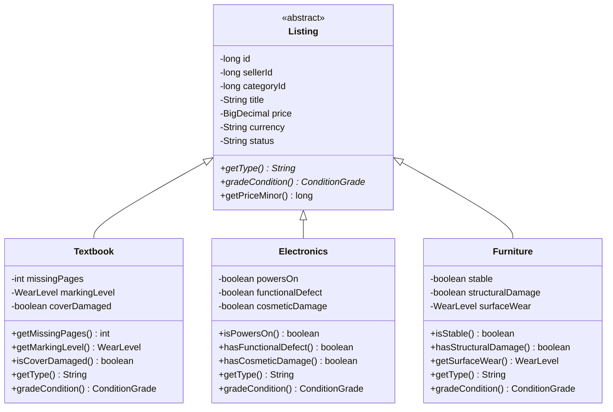
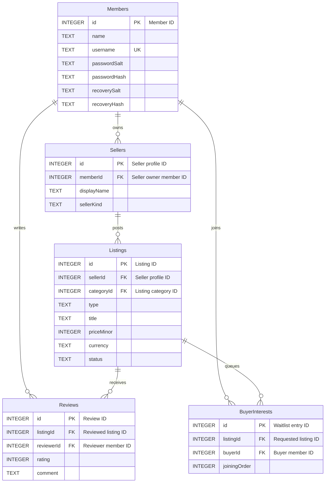
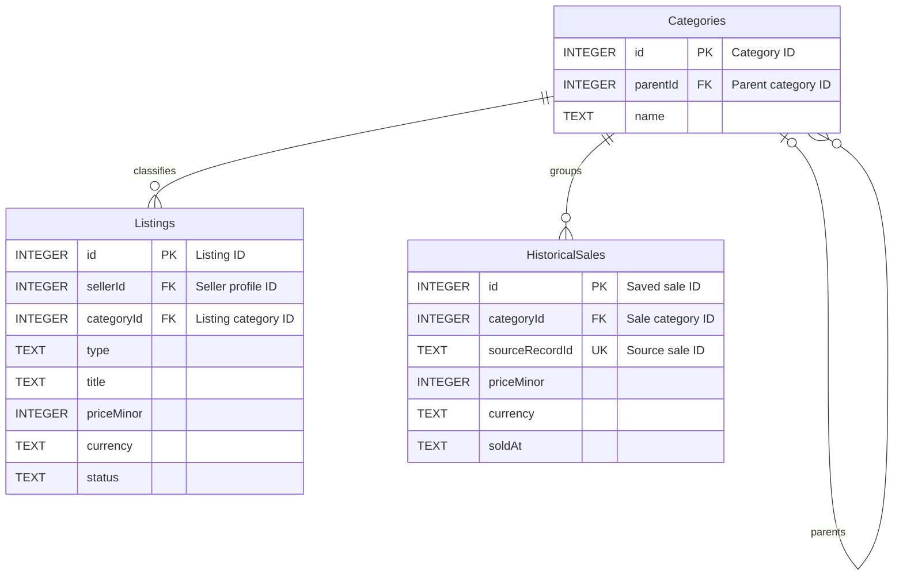
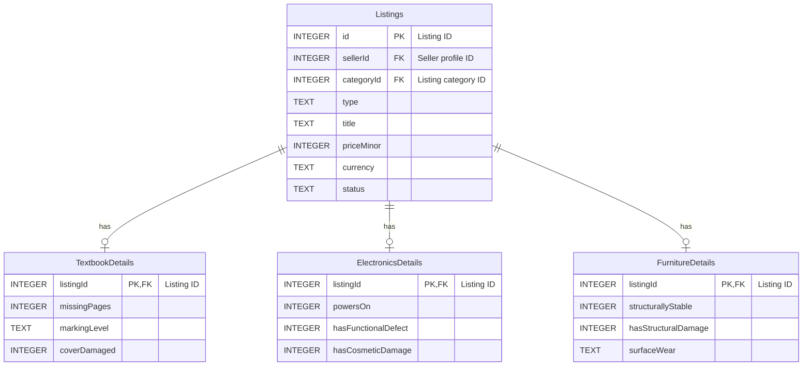

CPE 314 — Software Design

University of Cebu

Computer Engineering Department

# Campus Marketplace with Reviews

Project Design Document

Table 1: Group information

| Field | Details |
|---|---|
| Group Name / No. | Group 1 / Team 01 - BSCPE 3B - EDP 69323 |
| Members | John Benedict Alaiza |
|  | Acexion B. Mahigugmaon |
|  | Glyde V. Arreglado |
|  | Tristan Dominic Urot |
|  | Joshua Brian S. Enovero |
|  | Emanuelle De Paz |
| Instructor | Richyll Son |
| Term | First Semester, S.Y. 2026-2027 |
| Document Version / Date | V 0.3 / 9 November 2026 |

<!-- pagebreak -->

## Table of Contents

<!-- toc -->

<!-- pagebreak -->

## Revision History

Table 2: Document revisions

| Version | Date | Author | Changes |
|---|---|---|---|
| 0.1 | 23 Oct 2026 | Group 1 | Initial project overview, ER sketch and responsibilities. |
| 0.2 | 8 Nov 2026 | Group 1 | Documented the listing classes, named the IDs and clarified the table connections. |
| 0.3 | 9 Nov 2026 | Group 1 | Added the finalized class hierarchy, account login and recovery, updated screens, API and background processing, analytics and 81 passing tests. |

<!-- pagebreak -->

## 1. Introduction & Project Overview

Campus Marketplace with Reviews lets students, faculty and school groups buy and sell textbooks, electronics and furniture. Members search categories, join waitlists, review listings and compare category prices and ratings. Each item type calculates its own condition grade.

The JavaFX app stores records in SQLite and imports JSON sales history. Person A, Person B and Person C log in separately, then use Marketplace, Sell an item, Sales history and Analytics.

## 2. Preliminary ER Sketch & Team Roles

Each box is a table. Lines join primary keys (PK) to foreign keys (FK). The fork marks the many side of 1:M. Section 4 shows all fields, including login and recovery data.


[Editable diagram](assets/Figure_1_Preliminary_ER_Sketch.drawio)

Figure 1: Preliminary ownership and review relationships

Table 3: Team responsibilities

| Member and role | Responsibility |
|---|---|
| John Benedict Alaiza - Backend Developer (Listing Models) | Listing classes, condition rules and validation. |
| Acexion B. Mahigugmaon - Project Leader / Integration | Connect the components, maintain documents and coordinate fixes. |
| Glyde V. Arreglado - Database Admin | SQLite tables, saved records and summary queries. |
| Tristan Dominic Urot - UI/GUI Developer | JavaFX controls, event handlers and charts. |
| Joshua Brian S. Enovero - Backend & API Developer | Catalog requests, JSON parsing and import. |
| Emanuelle De Paz - QA & Testing | Test cases, expected calculations and error checks. |

<!-- pagebreak -->

## 3. System Architecture & Object-Oriented Design

Models hold item rules, MarketplaceService coordinates actions, Database handles SQL, and MarketplaceView handles the JavaFX screen. App connects these parts when the program starts.

### Class hierarchy



Figure 2: Listing class hierarchy and type-specific condition rules

The hollow triangle points to the parent class. A minus sign marks a private field and a plus sign marks a public method. An asterisk marks an abstract method. Each subclass inherits the shared listing data and public getters, then supplies its own item type and condition grade.

<!-- pagebreak -->

### Class responsibilities

The shared Listing fields are ID, seller/category IDs, title, price, currency and status. The abstract methods getType() and gradeCondition() are implemented by each subclass. A List<Listing> can hold all three types. Calling gradeCondition() through Listing runs the actual object's method; this is runtime polymorphism.

Table 4: Model responsibilities and Single Responsibility Principle

| Class | Responsibility and reason to change |
|---|---|
| Listing | Shared listing values and validation. Changes when common listing rules change. |
| Textbook | Textbook evidence and condition grade. Changes when textbook condition rules change. |
| Electronics | Electronics evidence and condition grade. Changes when electronics condition rules change. |
| Furniture | Furniture evidence and condition grade. Changes when furniture condition rules change. |
| ConditionGrade / WearLevel | Allowed grade and wear values. Changes when these allowed values change. |
| Member / Category | Member identity and category parent data. Changes when these records change. |

Keeping item rules separate from SQL and controls follows the Single Responsibility Principle. A changed grading rule belongs in its item class.

### Condition rules

- Textbook: missing pages = POOR; heavy markings = FAIR; light markings or cover damage = GOOD; otherwise LIKE_NEW.
- Electronics: no power or a functional defect = POOR; cosmetic damage = GOOD; otherwise LIKE_NEW.
- Furniture: unstable or structurally damaged = POOR; heavy wear = FAIR; light wear = GOOD; otherwise LIKE_NEW.

<!-- pagebreak -->

### Supporting components

Table 5: Supporting responsibilities

| Component | Responsibility and reason to change |
|---|---|
| App | Starts and connects the app; changes when startup setup changes. |
| MarketplaceView | Login, recovery, card/list screens, event handlers and refresh timer. Changes when the screen workflow changes. |
| MarketplaceService | Connects login, password reset, posting, ownership checks, categories and collections to the database. Changes when app rules change. |
| Database | Creates and upgrades tables, verifies credentials, resets passwords, saves records and queries summaries. Changes when storage rules change. |
| ProductCatalogClient | Requests, parses and matches public catalog products. Changes when the API or matching rules change. |
| CatalogProduct | Carries a catalog product's ID, title, category and price. Changes when the required product data changes. |
| SalesHistoryImporter | Validates JSON sales and imports them in a transaction. Changes when import rules change. |

### Collections and recursion

Waitlists use Queue with ArrayDeque: offer() adds at the tail and poll() reads the first buyer. Stored joiningOrder values rebuild FIFO order. A Map stores each member's Stack of recently viewed IDs. push() adds the latest view; pop() reads a copy, preserving session history. At most 20 unique views are kept per member.

collectCategoryIds() adds a category ID and recursively visits each child. A category without children is the base case. Validation rejects missing parents, duplicate IDs and cycles before traversal. Search includes the selected category and all descendants.

### Application screen and supporting classes

App opens MarketplaceView. Its controls call MarketplaceService to post, browse, view items and join waitlists. Database saves and loads the records.

The project has 15 top-level Java types, including its classes, records and enums. The responsibility tables name each type. Four nested records carry operation results.

ProductCatalogClient requests catalog data. CatalogProduct holds one product. SalesHistoryImporter reads past sales. ProductCatalogClient.Response carries the request result. SalesHistoryImporter.Result reports import counts and errors. Database.CategorySummary carries category averages and counts. Database.ListingForRepair identifies an owner's listing with missing condition data. The owner selects the observed condition and the database restores its missing detail row in a transaction.

<!-- pagebreak -->

### Sign in and password recovery

The app opens on the login page. The member enters a username and password. MarketplaceView.login() calls MarketplaceService.login(), which calls Database.authenticate(). Database trims the username, converts it to lowercase and reads its member row. It derives a password hash and compares it with the saved hash. A correct match opens the marketplace. An incorrect entry shows an error on the same form.

currentMember holds the signed-in Member object. Member contains only the member ID and display name. Credential values stay in Database and the Members table. Posting, reviews, waitlists, My listings and withdrawal use currentMember's ID. The three predefined accounts support the local classroom application. Their starting values are in the Appendix.

Passwords use PBKDF2WithHmacSHA256 with 210,000 iterations and a 256-bit result. A salt is random data used when deriving that hash. The salt and hash are encoded as Base64 text for SQLite. Login derives another hash from the entered password and the saved salt. MessageDigest.isEqual() compares the results. The view clears the password field and clears its temporary character array after verification.

Forgot password opens a form for the username, recovery code, new password and confirmation. The screen checks that the two new passwords match. Database.resetPassword() requires a password of 8 to 128 characters and checks the code against recoverySalt and recoveryHash. Failed checks show an error and keep the saved credentials.

A successful reset runs in one transaction. It saves a new password salt and hash, generates a random 24-character recovery code, and saves a new recovery salt and hash. It checks the previous recovery hash in the UPDATE so a used code cannot reset the account again. Any failure rolls back the transaction. The success screen shows the replacement code to copy and save. The member then returns to login and uses the new password. The replacement code is needed for the next reset.

Sign out clears the current account, form entries, displayed items, import results and chart data, stops the refresh timer and returns to login. Each window keeps its own signed-in account. A password reset affects later logins. An already signed-in window keeps its account until sign-out or close.

<!-- pagebreak -->

### Marketplace screens and ownership

Marketplace shows illustrated cards with title, type, price and condition. Cards and List switch between a card grid and a table containing the same saved listings. Clicking a card or View details loads the item's reviews, FIFO waitlist and the member's latest three viewed items. JavaFX draws a category illustration for each listing type. Cards shorten the supplied sample titles for display by hiding their '(demo)' suffix.

Search filters titles within the selected category and its descendants. My listings shows all items from the signed-in member's seller profile, including withdrawn items. This view lists all of that owner's items. Turning it off returns to the category and title search.

Sell an item opens the posting form. The member enters a title, positive PHP price, type, category and observed condition. The selected subclass calculates the condition grade. MarketplaceService obtains the signed-in member's seller profile. Database saves the listing and its matching detail row in one transaction. The screen reloads the records and returns to Marketplace.

Withdraw my listing asks for confirmation. Database.withdrawListing() checks the owner and AVAILABLE status in its UPDATE. A successful withdrawal changes the status to WITHDRAWN. The record remains visible under its owner's My listings. Available-item searches and chart calculations exclude it. Viewing details, joining its waitlist and reviewing it require an available listing.

Join waitlist accepts an existing member who is different from the seller. It saves joiningOrder and returns buyers in FIFO order. A repeated join is rejected and the original waitlist entry is preserved. View details updates that member's recent-view stack. Review listing accepts one review per member/item, a rating from 1 to 5, and an optional comment of up to 1,000 characters. The owner cannot review their own item. An accepted review is saved and the item's reviews reload.

If a listing has no condition-detail row, search reports its ID. Its owner can use Restore missing details, choose the item and explicitly choose its observed condition. The listing, reviews and waitlist are preserved. Database rechecks owner, type and missing details, and rolls back a failed save. Existing or conflicting detail rows require database-maintainer review.

<!-- pagebreak -->

### Listing types and sample records

Listing defines the shared item data. The application accepts three concrete types: Textbook, Electronics and Furniture. Database seeds one example of each when it creates the demo data. The user can post additional items of any supported type.

Table 6: Listings supplied with the prototype

| Listing and type | Category and price | Saved observations and result |
|---|---|---|
| Java textbook (demo) / TEXTBOOK | Textbooks / PHP 350.00 | No missing pages, light markings, intact cover. Grade: GOOD. |
| Gaming laptop (demo) / ELECTRONICS | Gaming Laptops / PHP 18,000.00 | Powers on, no functional defect, cosmetic damage. Grade: GOOD. |
| Study chair (demo) / FURNITURE | Furniture / PHP 650.00 | Stable, no structural damage, light surface wear. Grade: GOOD. |

### Categories and listing rules

All finds is the root category. Its direct children are Textbooks, Electronics and Furniture. Under Electronics, Computers contains Laptops, which contains Gaming Laptops. Searching a parent category includes items in its descendants.

Each new listing requires a seller profile, a category, a nonblank title, a positive price representable in whole minor units and a three-letter uppercase currency. The listing model trims spaces from the title. A post starts as AVAILABLE and uses the signed-in member's seller profile. The service supports owner withdrawal, which changes the status to WITHDRAWN. Marketplace search returns AVAILABLE items.

<!-- pagebreak -->

## 4. Data Model & Database Design

### Finalized entity relationships

The schema defines ten application tables with 49 stored fields. Members now includes five credential fields for login and password recovery. The ERD is split into three views for readability; Listings is repeated to connect the views. Every table attribute is included. TEXT and INTEGER are SQLite types. The schema below specifies nullability and checks.

Read 1:M as one parent to many children. A parent can have no children. M:N (also called M:M) means many-to-many. Members and Listings have this relationship through BuyerInterests for waitlists and through Reviews for ratings. Each connecting table has two 1:M links. Each individual listing subtype uses 1:1; only the matching subtype has a row.



Figure 3: Members, sellers, listings, reviews and buyer interests

<!-- pagebreak -->

### Categories and historical sales



Figure 4: Categories, current listings and imported historical sales

A root category has NULL parentId. A non-root category has one parent, and a parent can have zero or more children. HistoricalSales contains imported past sales, not new marketplace listings. sourceRecordId prevents duplicate imports.

<!-- pagebreak -->

### Listing condition details



Figure 5: Shared listing fields and type-specific condition evidence

A valid listing needs exactly one matching detail row overall. It has zero or one row in each individual detail table, depending on type. A detail row's listingId is both its primary key and its foreign key. The app saves the listing and detail row in one transaction, and checks the type when reading. Foreign keys alone do not guarantee exactly one matching subtype.

Some Java names are shorter than their SQL columns. Electronics.functionalDefect maps to hasFunctionalDefect, and cosmeticDamage maps to hasCosmeticDamage. Furniture.stable maps to structurallyStable, and structuralDamage maps to hasStructuralDamage. Database converts boolean values to SQLite 0/1 and wear enums to their text names.

<!-- pagebreak -->

### Whose ID is it?

A primary key (PK) identifies one row in its own table. A foreign key (FK) identifies a related row. In the diagrams, Member ID means Members.id, Seller profile ID means Sellers.id, and Listing ID means Listings.id. The SQLite name id always belongs to the table where it appears.

Table 7: IDs used to connect marketplace records

| SQLite field | What it identifies |
|---|---|
| Sellers.memberId | The member who owns the seller profile. Links to Members.id. |
| Listings.sellerId | The seller profile that posted this item. Links to Sellers.id. |
| Listings.categoryId | The item's category. Links to Categories.id. |
| Categories.parentId | The parent category. Links to Categories.id; empty for a root category. |
| Reviews.listingId | The listing being reviewed. Links to Listings.id. |
| Reviews.reviewerId | The member who wrote the review. Links to Members.id. |
| BuyerInterests.listingId | The listing whose waitlist the buyer joined. Links to Listings.id. |
| BuyerInterests.buyerId | The member who joined the waitlist. Links to Members.id. |
| HistoricalSales.categoryId | The category of the imported sale. Links to Categories.id. |
| TextbookDetails.listingId, ElectronicsDetails.listingId, FurnitureDetails.listingId | In each table, this is both PK and FK. It identifies the listing whose condition is described and links to Listings.id. |

Example: Review ID 7, Reviewed listing ID 12 and Reviewer member ID 3 mean that member 3 wrote review 7 about listing 12.

HistoricalSales.id identifies the locally saved sale. HistoricalSales.sourceRecordId is the unique ID supplied by the JSON file to recognize a repeat import.

### Account fields and database upgrades

Members.id identifies the member. username is marked UK because its unique index keeps login names distinct. passwordSalt and passwordHash verify the entered password. recoverySalt and recoveryHash verify a recovery code. Salts and hashes are saved as text. Member objects passed to the screen contain only id and name.

Database.initialize() upgrades versions 1 and 2 to version 3 in a transaction. It adds missing account fields and the unique username index, keeps existing credentials and preserves the member IDs and related records. The default account names become Person A/B/C. PRAGMA user_version stores the schema version. The five account fields belong to Members.

<!-- pagebreak -->

### Relationships and storage rules

Table 8: Relationship cardinalities

| Parent | Child | Relationship |
|---|---|---|
| Members | Sellers | 1:M |
| Members | Reviews | 1:M |
| Members | BuyerInterests | 1:M |
| Sellers | Listings | 1:M |
| Categories | Listings | 1:M |
| Categories | HistoricalSales | 1:M |
| Categories | Categories | 1:M; a root has no parent |
| Listings | Reviews | 1:M |
| Listings | BuyerInterests | 1:M |
| Listings | Each detail table | 1:1; only the matching subtype applies |

Prices use integer minor units: PHP 350.50 is stored as priceMinor 35050 and currency PHP. Java uses BigDecimal. The app uses AVAILABLE and WITHDRAWN status values. Required names are nonblank; review ratings range from 1 to 5. The application prevents self-review and repeat reviews through the app's serialized transaction path.

Foreign keys are enabled on every SQLite connection. PreparedStatement binds input values to SQL. Each operation opens its own connection. Saving a listing with its detail record and restoring missing details both use transactions and roll back on failure.

The following CREATE TABLE statements match program/src/main/resources/db/schema.sql. Each snippet defines one table. The username index is created by Database.initializeAccounts().

### Members

```sql
CREATE TABLE Members (
    id INTEGER PRIMARY KEY,
    name TEXT NOT NULL CHECK (length(trim(name)) > 0),
    username TEXT,
    passwordSalt TEXT,
    passwordHash TEXT,
    recoverySalt TEXT,
    recoveryHash TEXT
);
```

Database.initializeAccounts() also runs this index statement.

```sql
CREATE UNIQUE INDEX IF NOT EXISTS idx_Members_username ON Members(username);
```

### Sellers

```sql
CREATE TABLE Sellers (
    id INTEGER PRIMARY KEY,
    memberId INTEGER NOT NULL REFERENCES Members(id),
    displayName TEXT NOT NULL CHECK (length(trim(displayName)) > 0),
    sellerKind TEXT NOT NULL CHECK (length(trim(sellerKind)) > 0)
);
```

### Categories

```sql
CREATE TABLE Categories (
    id INTEGER PRIMARY KEY,
    parentId INTEGER REFERENCES Categories(id),
    name TEXT NOT NULL CHECK (length(trim(name)) > 0),
    CHECK (parentId IS NULL OR parentId <> id)
);
```

### Listings

```sql
CREATE TABLE Listings (
    id INTEGER PRIMARY KEY,
    sellerId INTEGER NOT NULL REFERENCES Sellers(id),
    categoryId INTEGER NOT NULL REFERENCES Categories(id),
    type TEXT NOT NULL CHECK (type IN ('TEXTBOOK', 'ELECTRONICS', 'FURNITURE')),
    title TEXT NOT NULL CHECK (length(trim(title)) > 0),
    priceMinor INTEGER NOT NULL
       
        CHECK (typeof(priceMinor) = 'integer' AND priceMinor > 0),
    currency TEXT NOT NULL
       
        CHECK (length(currency) = 3 AND currency NOT GLOB '*[^A-Z]*'),
    status TEXT NOT NULL CHECK (length(trim(status)) > 0)
);
```

### Reviews

```sql
CREATE TABLE Reviews (
    id INTEGER PRIMARY KEY,
    listingId INTEGER NOT NULL REFERENCES Listings(id),
    reviewerId INTEGER NOT NULL REFERENCES Members(id),
    rating INTEGER NOT NULL
       
        CHECK (typeof(rating) = 'integer' AND rating BETWEEN 1 AND 5),
    comment TEXT
);
```

### BuyerInterests

```sql
CREATE TABLE BuyerInterests (
    id INTEGER PRIMARY KEY,
    listingId INTEGER NOT NULL REFERENCES Listings(id),
    buyerId INTEGER NOT NULL REFERENCES Members(id),
    joiningOrder INTEGER NOT NULL
       
        CHECK (typeof(joiningOrder) = 'integer' AND joiningOrder > 0),
    UNIQUE (listingId, buyerId),
    UNIQUE (listingId, joiningOrder)
);
```

### HistoricalSales

```sql
CREATE TABLE HistoricalSales (
    id INTEGER PRIMARY KEY,
    categoryId INTEGER NOT NULL REFERENCES Categories(id),
    sourceRecordId TEXT NOT NULL UNIQUE
        CHECK (length(trim(sourceRecordId)) > 0),
    priceMinor INTEGER NOT NULL
       
        CHECK (typeof(priceMinor) = 'integer' AND priceMinor > 0),
    currency TEXT NOT NULL
       
        CHECK (length(currency) = 3 AND currency NOT GLOB '*[^A-Z]*'),
    soldAt TEXT NOT NULL CHECK (length(trim(soldAt)) > 0)
);
```

### TextbookDetails

```sql
CREATE TABLE TextbookDetails (
    listingId INTEGER PRIMARY KEY REFERENCES Listings(id) ON DELETE CASCADE,
    missingPages INTEGER NOT NULL
       
        CHECK (typeof(missingPages) = 'integer' AND missingPages >= 0),
    markingLevel TEXT NOT NULL CHECK (markingLevel IN ('NONE', 'LIGHT', 'HEAVY')),
    coverDamaged INTEGER NOT NULL
       
        CHECK (typeof(coverDamaged) = 'integer' AND coverDamaged IN
        (0, 1))
);
```

### ElectronicsDetails

```sql
CREATE TABLE ElectronicsDetails (
    listingId INTEGER PRIMARY KEY REFERENCES Listings(id) ON DELETE CASCADE,
    powersOn INTEGER NOT NULL
       
        CHECK (typeof(powersOn) = 'integer' AND powersOn IN
        (0, 1)),
    hasFunctionalDefect INTEGER NOT NULL
       
        CHECK (typeof(hasFunctionalDefect) = 'integer' AND hasFunctionalDefect IN
        (0, 1)),
    hasCosmeticDamage INTEGER NOT NULL
       
        CHECK (typeof(hasCosmeticDamage) = 'integer' AND hasCosmeticDamage IN
        (0, 1))
);
```

### FurnitureDetails

```sql
CREATE TABLE FurnitureDetails (
    listingId INTEGER PRIMARY KEY REFERENCES Listings(id) ON DELETE CASCADE,
    structurallyStable INTEGER NOT NULL
       
        CHECK (typeof(structurallyStable) = 'integer' AND structurallyStable IN
        (0, 1)),
    hasStructuralDamage INTEGER NOT NULL
       
        CHECK (typeof(hasStructuralDamage) = 'integer' AND hasStructuralDamage IN
        (0, 1)),
    surfaceWear TEXT NOT NULL CHECK (surfaceWear IN ('NONE', 'LIGHT', 'HEAVY'))
);
```

<!-- pagebreak -->

## 5. API Integration Design

### Catalog request and response

The app consumes FakeStoreAPI to suggest an electronics category and show comparable catalog prices. Clicking Suggest category / price makes a fresh GET request to https://fakestoreapi.com/products. No API key is required.

Example response shape (illustrative values):

```json
[
  {
    "id": 1, "title": "Example monitor", "price": 120.50,
    "category": "electronics", "description": "Product details",
    "image": "https://example.com/product.png",
    "rating": {"rate": 4.2, "count": 25}
  }
]
```

ProductCatalogClient uses Java HttpClient with a 15-second timeout. It checks HTTP 200, parses the JSON with Gson and validates product values. CatalogProduct holds id, title, category and BigDecimal price. Other response fields are not used by this feature.

### How a suggestion reaches the listing form

ProductCatalogClient.matches() keeps electronics products that share a title word with the listing. It ignores words shorter than three characters and common words such as “the” and “for”. It ranks products by the number of shared words, breaks ties by product ID and returns up to three matches. The screen selects the local Electronics category and shows the matching product titles and the lowest and highest reference prices. The member may choose a child category and enters the final PHP price manually.

The API does not identify the price currency. The app labels the range as a catalog reference with unspecified currency and never silently converts it to PHP. Textbook/furniture or unmatched queries retain manual entry. A timeout, failed status or invalid JSON displays a retry/manual-entry message. A form changed during the request does not receive a stale suggestion. The screen shows request time and HTTP status.

<!-- pagebreak -->

## 6. Concurrency Design

Database setup, login verification, password reset, posting, reads, HTTP requests, JSON imports and database summaries run on a background worker. MarketplaceView.runTask() creates a JavaFX Task; one ExecutorService executes it. JavaFX reads form values before starting the task. Success and failure callbacks update controls on the JavaFX thread. Platform.runLater() delivers import progress to that thread.

### Background JSON import

SalesHistoryImporter streams a UTF-8 JSON array one row at a time. Each record contains sourceRecordId, categoryPath, price, currency and soldAt. Validation checks required values, an existing unique category path, a positive price with exact minor units, an uppercase currency and a timestamp with timezone.

Valid rows go into HistoricalSales. Duplicate source IDs and invalid field values are skipped and counted. One transaction commits the new rows only after the file is read successfully. Broken JSON, database failure or cancellation rolls back the new rows from that import. Existing saved sales remain.

### Automatic updates between windows

A JavaFX Timeline ticks every three seconds after login. autoRefresh() reads the visible Marketplace or Analytics page through runAutoRefresh() on the existing worker. Its success handler checks the account, page and filters before applying changed results. Unchanged rows and the selected item are preserved.

The check uses the current category, title search, My listings choice and chart currency. It skips a tick during a busy action, an existing timer read or an open dialog. It stops at sign-out and close. A failed read shows a status message and allows retry.

Three windows using the same local database sign in separately. Person A's post or withdrawal reaches the other visible Marketplace/Analytics pages on their next successful check. A busy window updates after finishing its work. Sell an item and Sales history update through their own actions. View details or the related action reloads the selected item's review/waitlist text.

The view stores busy, automaticRefreshRunning, ready, currentMember and analyticsSnapshot in memory. They track pending work, setup, the signed-in account and the last chart results. These per-window values add no database columns.

### Responsiveness and cancellation

The busy flag rejects overlapping operations. Only work buttons are disabled; tabs, loaded table selection/scrolling, form fields and About remain usable. The import panel displays progress and provides Cancel import. Cancel sets a flag checked between records, and the importer rolls back when it notices the flag. The progress label updates after the first record and every 1,000 records. After the transaction commits, the screen shows saved, invalid and duplicate counts, up to five validation messages, and the latest 20 imported sales. If the preview fails, the screen still reports that the import was saved.

Each database operation owns its connection. Closing the app requests cancellation and shuts down the executor. 

<!-- pagebreak -->

## 7. Data Mining & Visualization Design

The Analytics tab reads saved marketplace data and calculates an average and a record count for each qualifying category. The results help a member compare listing prices and campus review ratings.

### How category averages are calculated

Table 9: Category calculations

| Result | Calculation and data |
|---|---|
| Average listing price | AVAILABLE Listings in the selected currency, grouped by category: AVG(priceMinor) / 100.0; COUNT(*) gives listing count. |
| Average review rating | Reviews joined to AVAILABLE Listings, grouped by category: AVG(rating); COUNT(*) gives review count. Highest average identifies the best-rated category; ties are shown. |

Separate queries prevent multiple reviews from counting the same listing price repeatedly. Different currencies remain separate. Imported HistoricalSales and external API prices/ratings are excluded from these two calculations. A category without campus reviews is unrated, not zero stars.

### Charts and why they fit

Two JavaFX bar charts compare category averages. Each bar represents one category, so bar height makes differences easy to see.

- Average listing price by category: X-axis Category; Y-axis Price in the selected currency, initially PHP.
- Average review rating by category: X-axis Category; Y-axis Rating, on a 0-5 scale.

Both charts have titles and axis labels. Each uses one series, so a legend is unnecessary. Refresh analytics reads current database summaries. The three-second timer also refreshes this page while it is visible. Empty results show a no-data title; the screen reports the best-rated category with its review count.

Example: PHP 100 and PHP 200 average PHP 150. Adding PHP 300 makes the average PHP 200. Review ratings 4 and 5 average 4.5. The app calculates these values from saved rows.

<!-- pagebreak -->

## Appendix - References and reproduction

design-document.md is the editable text source. The class hierarchy and detailed ER diagrams are written in Mermaid in this file. The preliminary sketch uses the linked draw.io source and its PNG preview in assets/. Section 4 diagrams use the field definitions in this master.

Use JDK 21 for the Java project and Maven launch. The enforcer range [21,22) intentionally rejects JDK 17 and 25. From program/, run `java -version`, `./mvnw.cmd -version`, then `./mvnw.cmd clean verify`. Both version checks must show Java 21; do not skip the enforcer to claim a normal build. The existing Eclipse Java Application and Antigravity Run profiles remain available.

### Class accounts and recovery

The first setup supplies these local accounts. Later password resets replace the password and recovery code for that account.

Table 10: Starting account details

| Account and username | Starting password | Starting recovery code |
|---|---|---|
| Person A / person_a | CampusA123! | RESET-A-2026 |
| Person B / person_b | CampusB123! | RESET-B-2026 |
| Person C / person_c | CampusC123! | RESET-C-2026 |

After a reset, copy the replacement code from the success screen before returning to login. It is needed for a later reset. This local application uses predefined accounts and recovery codes. It has no email-recovery service, registration screen or online payment flow.

### Verification

On 9 November 2026, Maven verify passed 81 JUnit tests with zero failures, errors or skipped tests. They cover model rules, login and recovery boundaries, failed-reset rollback, database upgrades, account ownership, separate sessions, API response validation and timeouts, JSON import progress and rollback, and category price/review calculations. Database tests use temporary files. HTTP tests use local test servers.

Separate app checks on 8 November covered 22 login, recovery and screen interactions and 13 checks across three windows for automatic refresh. These app checks are counted separately from the 81 JUnit tests.

- [Team repository](https://github.com/XionAce/cpe314-69323-capstone-team-01)
- [Project proposal](https://drive.google.com/file/d/1YbkejbixAvcU1AAcr1zVOpNSHEY_54cH/view)
- [FakeStoreAPI documentation](https://fakestoreapi.com/docs)
- [Project Design Document Template](https://drive.google.com/file/d/1sRJ5rjciHBeYgBQmUbpJB12kWyD_sCkO/view)
- [Project Design Document Checklist](https://drive.google.com/file/d/1QG1zJGib8TXtcc-Ur_awPQRklWvUheQa/view)

<!-- pagebreak -->

### Program process map

All Java classes below are in edu.uc.campusmarket or its listed subpackage. schema.sql is under src/main/resources/db. marketplace.css is under src/main/resources/ui.

Table 11: Where the implemented processes are handled

| Process | Screen or service entry | Stored result or purpose |
|---|---|---|
| Startup and upgrade | App / start(); Database / initialize() | Opens SQLite, upgrades accounts and loads categories. |
| Login | MarketplaceView / login(); MarketplaceService / login() | Database / authenticate() verifies credentials and returns Member. |
| Forgot password | MarketplaceView / showPasswordReset(); MarketplaceService / resetPassword() | Database / resetPassword() atomically replaces both credential hashes and returns a new recovery code. |
| Cards and List | MarketplaceView / showListingCards(); createListings() | Both views use the same listing data. itemIllustration() draws category art. |
| Search and recursion | MarketplaceService / search(); categoryIdsUnder() | collectCategoryIds() visits descendant categories before searching available items. |
| Post and condition | MarketplaceView / postListing(); MarketplaceService / post() | Database / insertListing() saves Listing and the correct detail row. Subclass gradeCondition() calculates its grade. |
| Owner items and withdrawal | MarketplaceService / myListings(); withdraw() | Database / withdrawListing() checks owner and sets WITHDRAWN. |
| View history and waitlist | MarketplaceService / view(); recent(); joinWaitlist() | Recent views use a per-member stack. BuyerInterests saves FIFO joiningOrder. |
| Reviews and repair | MarketplaceService / review(); restoreDetails() | Database / addReview() validates a review. restoreDetails() transactionally restores missing condition evidence. |
| API suggestions | MarketplaceView / suggest(); ProductCatalogClient / fetch()/matches() | Parses CatalogProduct records and displays matching references in the selling form. |
| JSON import | MarketplaceView / startImport(); SalesHistoryImporter / importFile() | Valid rows go to HistoricalSales in a transaction. Cancellation or malformed JSON rolls back that import. |
| Automatic refresh | MarketplaceView / autoRefresh(); runAutoRefresh() | Reads the active listings/charts every three seconds and checks the account/page/filters before applying results. |
| Charts | Database / priceSummary()/ratingSummary(); MarketplaceView / showAnalytics() | Separate averages and counts feed the two bar charts. |
| Sign out and close | MarketplaceView / logout()/close() | Clears displayed account data, stops the timer, requests cancellation and shuts down the worker on close. |
