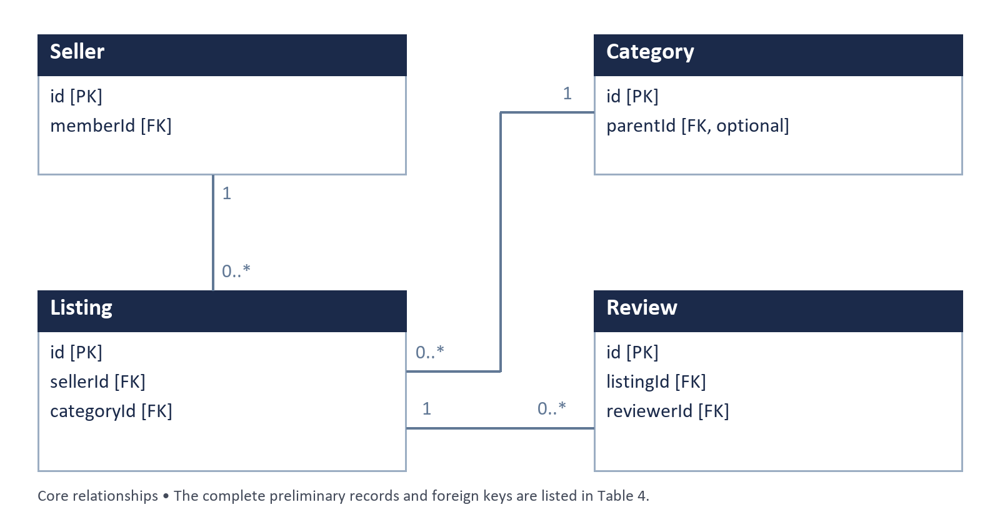

# UC-B Campus Marketplace with Reviews — Project Design Document

CPE 314 — Software Design & Software Design Laboratory

University of Cebu — Computer Engineering Department

Instructor: Richyll Son

Term: First Semester, S.Y. 2026–2027

Group 1 / Team 01 · BSCPE 3B · EDP 69323

Version 0.3 — 23 October 2026 — Week 8 draft

Members: John Benedict Alaiza; Acexion B. Mahigugmaon; Glyde V. Arreglado; Tristan Dominic Urot; Joshua Brian S. Enovero; Eman De Paz

[Formatted Word document](design-document.docx) · [PDF copy](design-document.pdf)

## Revision History

| Version | Date | Changes |
|---|---|---|
| 0.1 | 17 October 2026 | Initial planning draft |
| 0.2 | 18 October 2026 | Working title, roster and assigned theme updated |
| 0.3 | 23 October 2026 | Week 8 template draft with introduction, ER sketch and roles |

## 1. Introduction & Project Overview

UC-B Campus Marketplace with Reviews is a proposed Java desktop application for students, faculty, school units, and department committees to post and browse campus goods. Our assigned theme is Option J, retaining Textbook, Electronics, and Furniture listing types with different condition-grading rules, nested category search, buyer-interest waitlists, recently viewed listings, and reviews. We plan to use JavaFX, SQLite through JDBC, a background sales-history CSV import, FakeStoreAPI product suggestions, and category price and rating bar charts. Uniforms and department merchandise are proposed additions for instructor review; the initial application uses local storage, with online payments outside its scope.

## 2. Preliminary ER Sketch & Team Roles

Figure 1: Core preliminary entity relationships

### 2.1 Key Attributes and Relationships

Table 4: Preliminary entities and key attributes

| Entity | Key attributes |
|---|---|
| Member | id PK; name |
| Seller | id PK; memberId FK → Member.id; displayName; sellerKind |
| Category | id PK; parentId FK → Category.id; name |
| Listing | id PK; sellerId FK → Seller.id; categoryId FK → Category.id; type; title; priceMinor; currency; status |
| Review | id PK; listingId FK → Listing.id; reviewerId FK → Member.id; rating; comment |
| BuyerInterest | id PK; listingId FK → Listing.id; buyerId FK → Member.id; joiningOrder |
| HistoricalSale | id PK; categoryId FK → Category.id; sourceRecordId; priceMinor; currency; soldAt |

Member 1:M Seller, Review and BuyerInterest. Seller 1:M Listing. Category 1:M Listing, child Category and HistoricalSale. Listing 1:M Review and BuyerInterest. Category.parentId is optional for roots. PK identifies a record; FK refers to another record. Subtype-details fields remain preliminary.

### 2.2 Team Roles

Table 5: Proposed primary responsibilities for Week 8

| Member | Primary responsibility |
|---|---|
| John Benedict Alaiza | Sample listings, categories and condition examples. |
| Acexion B. Mahigugmaon | Architecture, implementation planning and integration. |
| Glyde V. Arreglado | ER sketch, attributes and relationship review. |
| Tristan Dominic Urot | GUI sketches, control labels and user steps. |
| Joshua Brian S. Enovero | Sample CSV and API/import validation cases. |
| Eman De Paz | Test cases and expected analytics calculations. |

These are proposed responsibilities for member confirmation. Actual contributions and supporting commits will be recorded in Section 9.

## 3. System Architecture & Object-Oriented Design

Reserved for a later milestone. Add the class hierarchy, responsibilities and design rationale after the proposal is approved and the implementation is developed.

## 4. Data Model & Database Design

Reserved for a later milestone. Finalize the ERD, SQL types, constraints and SQLite schema. Section 2 contains the preliminary proposal model only.

## 5. API Integration Design

Reserved for a later milestone. Document the actual endpoint response, parsing, comparable-product matching, currency policy and failure handling after verification.

## 6. Concurrency Design

Reserved for a later milestone. Record the implemented background import/API work, UI update approach, cancellation and error handling.

## 7. Data Mining & Visualization Design

Reserved for a later milestone. Document the implemented category calculations, sample counts, currency handling and labeled charts.

## 8. Testing Summary

Reserved for a later milestone. No application test suite or execution results are recorded in this Week 8 draft. Add actual JUnit coverage, edge cases and results when available.

## 9. Individual Contributions

Contribution records will be added with verified commit references. The roles in Section 2 describe proposed responsibilities and do not claim completed implementation.

## Appendix

The formatted document retains the template’s title page, table of contents, revision history, formatting reference, nine numbered sections and appendix.

- [Project repository](https://github.com/XionAce/cpe314-69323-capstone-team-01)
- [Project proposal](https://github.com/XionAce/cpe314-69323-capstone-team-01/blob/project/proposal/docs/proposal.md)
- [Student Guide — Group Capstone Project](https://drive.google.com/file/d/195Y8cNaHnd0M7FpIwmKDYzfok5pbKZti/view)
- [Week 8 design-document checklist](https://drive.google.com/file/d/1wb9xb2nd7RDowEEbSMx-M-l58qnO9gMM/view)
- [Project design-document template](https://drive.google.com/file/d/1sRJ5rjciHBeYgBQmUbpJB12kWyD_sCkO/view)
- [FakeStoreAPI documentation](https://fakestoreapi.com/docs)

Instructor approval, final implementation ownership, API behavior and currency decisions remain to be confirmed.
