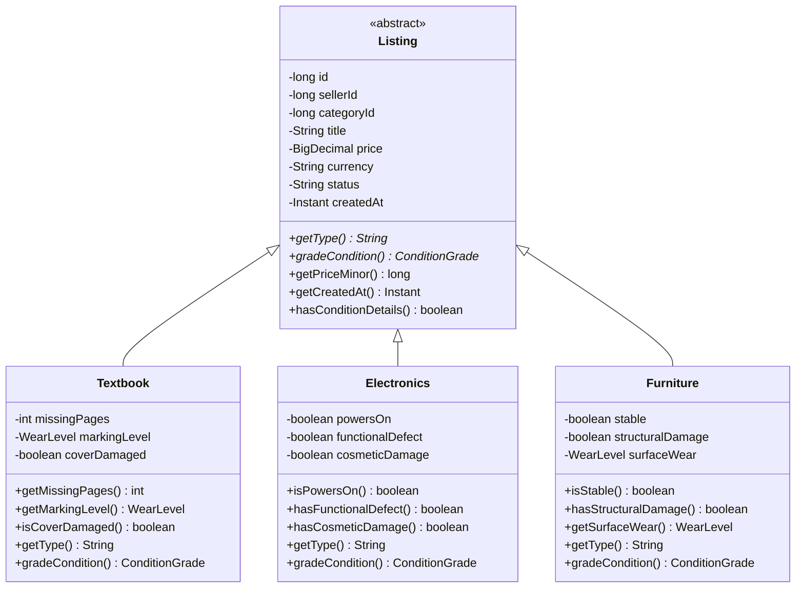
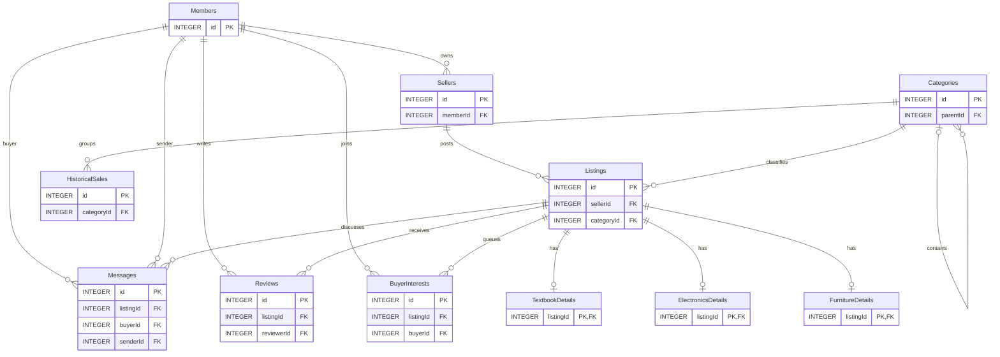
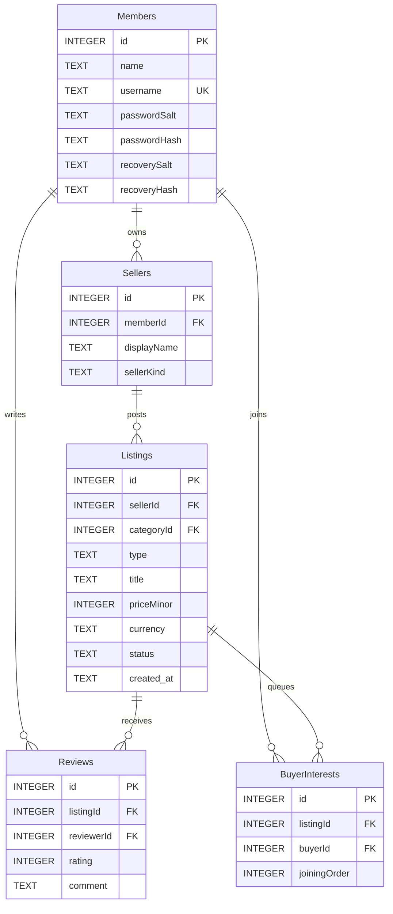
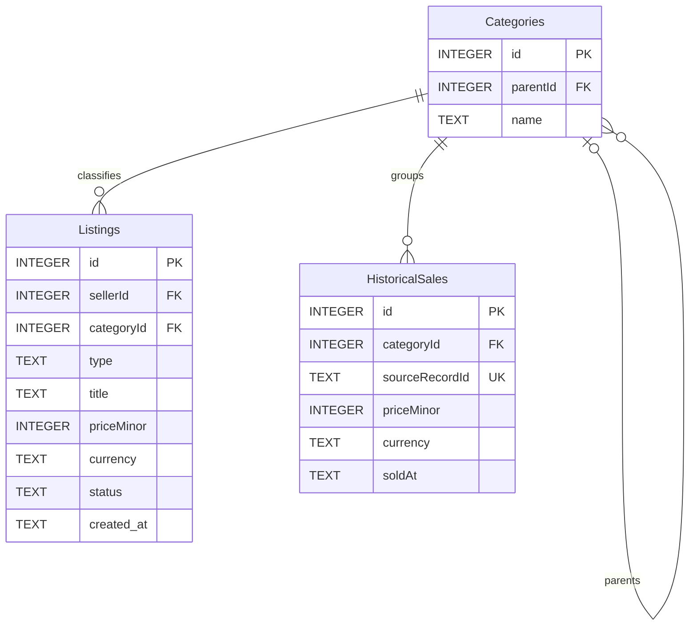
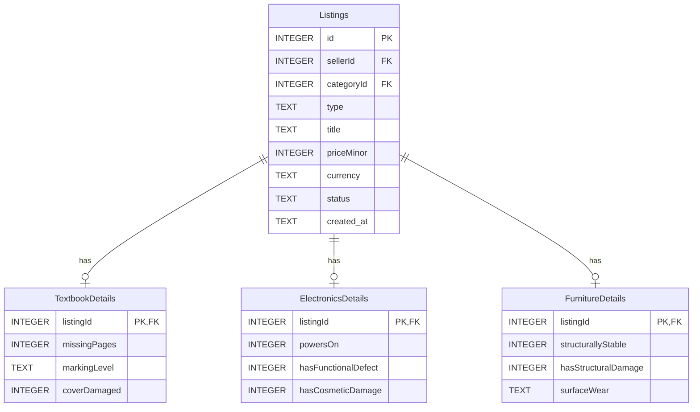
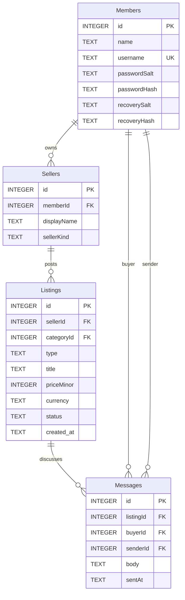

CPE 314 - Software Design

University of Cebu

Computer Engineering Department

# Campus Marketplace with Reviews

Project Design Document

Table 1: Group information

| Field | Details |
|---|---|
| Group Name / No. | Group 1 / Team 01 - BSCPE 3B - EDP 69323 |
| Members | John Benedict Alaiza |
|  | Acexion B. Mahigugmaon |
|  | Glyde V. Arreglado |
|  | Tristan Dominic Urot |
|  | Joshua Brian S. Enovero |
|  | Emanuelle De Paz |
| Instructor | Richyll Son |
| Term | First Semester, S.Y. 2026-2027 |
| Document Version / Date | V 1.0 / 14 November 2026 |

<!-- pagebreak -->

## Table of Contents

<!-- toc -->

<!-- pagebreak -->

## Revision History

Table 2: Document revisions

| Version | Date | Author | Changes |
|---|---|---|---|
| 0.1 | 23 Oct 2026 | Group 1 | Initial project overview, ER sketch and responsibilities. |
| 0.2 | 8 Nov 2026 | Group 1 | Documented the listing classes, named the IDs and clarified the table connections. |
| 0.3 | 13 Nov 2026 | Group 1 | Registration, MVC, Java analysis, listing dates/status, safer detail handling and matching diagrams/tests. |
| 1.0 | 14 Nov 2026 | Group 1 | Compiled Sections 1-9; documented private listing chats, database upgrade, testing evidence and commit-linked contributions; checked diagrams and page navigation. |

<!-- pagebreak -->

## 1. Introduction & Project Overview

Campus Marketplace with Reviews lets students, faculty and school groups buy and sell textbooks, electronics and furniture. Members search categories, join waitlists, review listings and compare category prices and ratings. Each item type calculates its own condition grade.

The JavaFX app stores records in SQLite and imports JSON sales history. Members register or use the initial local accounts, then sign in to Marketplace, Sell an item, Sales history, Analytics and Messages. Messages lets a buyer and seller discuss an item and arrange a meeting. Messages are local to the shared SQLite file; separate laptops are not synchronized. Offers and payment processing remain outside the application.

## 2. Preliminary ER Sketch & Team Roles

Each box is a table. Lines join primary keys (PK) to foreign keys (FK). The fork marks the many side of 1:M. Section 4 shows all fields, including login and recovery data.


[Editable diagram](assets/Figure_1_Preliminary_ER_Sketch.drawio)

Figure 1: Preliminary ownership and review relationships

Table 3: Team responsibilities

| Member and role | Responsibility |
|---|---|
| John Benedict Alaiza - Backend Developer (Listing Models) | Listing classes, condition rules and validation. |
| Acexion B. Mahigugmaon - Project Leader / Integration | Connect the components, maintain documents and coordinate fixes. |
| Glyde V. Arreglado - Database Admin | SQLite tables, saved records and summary queries. |
| Tristan Dominic Urot - UI/GUI Developer | JavaFX controls, event handlers and charts. |
| Joshua Brian S. Enovero - Backend & API Developer | Catalog requests, JSON parsing and import. |
| Emanuelle De Paz - QA & Testing | Test cases, expected calculations and error checks. |

<!-- pagebreak -->

## 3. System Architecture & Object-Oriented Design

Models hold item rules. Views show controls, controllers coordinate actions, services apply rules and DAOs run feature SQL. Database opens SQLite and initializes records. App connects these parts when the program starts.

### Class hierarchy



Figure 2: Listing class hierarchy and type-specific condition rules

The hollow triangle points to the parent class. A minus sign marks a private field and a plus sign marks a public method. An asterisk marks an abstract method. Each subclass inherits the shared listing data and public getters, then supplies its own item type and condition grade.

<!-- pagebreak -->

### Class responsibilities

The shared Listing fields are ID, seller/category IDs, title, price, currency, status and creation time. The abstract methods getType() and gradeCondition() are implemented by each subclass. A List<Listing> can hold all three types. Calling gradeCondition() through Listing runs the actual object's method; this is runtime polymorphism.

Table 4: Model responsibilities and Single Responsibility Principle

| Class | Responsibility and reason to change |
|---|---|
| Listing | Shared listing values and validation. Changes when common listing rules change. |
| Textbook | Textbook evidence and condition grade. Changes when textbook condition rules change. |
| Electronics | Electronics evidence and condition grade. Changes when electronics condition rules change. |
| Furniture | Furniture evidence and condition grade. Changes when furniture condition rules change. |
| ConditionGrade / WearLevel | Allowed grade and wear values. Changes when these allowed values change. |
| Member / Category | Member identity and category parent data. Changes when these records change. |

Keeping item rules separate from SQL and controls follows the Single Responsibility Principle. A changed grading rule belongs in its item class.

### Condition rules

- Textbook: missing pages = POOR; heavy markings = FAIR; light markings or cover damage = GOOD; otherwise LIKE_NEW.
- Electronics: no power or a functional defect = POOR; cosmetic damage = GOOD; otherwise LIKE_NEW.
- Furniture: unstable or structurally damaged = POOR; heavy wear = FAIR; light wear = GOOD; otherwise LIKE_NEW.

<!-- pagebreak -->

### Supporting components

Table 5: Application layers and responsibilities

| Layer | Responsibility and reason to change |
|---|---|
| App | Creates the database, DAOs, services, controllers and views. Owns the shared worker and shutdown. |
| Views in ui | Draw controls, bind state, show dialogs and forward actions. Contain no SQL, API calls or worker creation. |
| Controllers | Hold observable state, obtain the active member from UserSession and request background work. |
| Services | Apply account, listing, review and analysis rules. Convert data-access failures before they reach the screen. |
| DAOs | Execute prepared SQL and return records. Recheck storage-sensitive rules in write transactions. |
| Database / AccountSetup | Open connections, create tables, seed initial records and migrate account fields without erasing saved data. |
| ProductCatalogClient / ProductCatalogParser | Download the catalog and validate its JSON in separate classes. |
| CatalogProduct / CatalogResponse | Carry the parsed product subset and HTTP information in dto. |
| CatalogMapper / CatalogService | Select supported comparable products and prepare reference information. |
| ChatController / ChatService / ChatDao | Load private conversations, validate messages and save participant-filtered results. |
| SalesHistoryImporter / SalesAnalysis | Stream and validate JSON imports; group saved timestamps and count weekly activity in Java. |

The action path is View -> Controller -> Service -> DAO -> SQLite. Task results update controller properties on the JavaFX thread; bound views display them. Models contain no GUI or SQL. The Appendix lists every top-level Java type and the process map.

<!-- pagebreak -->

### Collections and recursion

Waitlists use Queue with ArrayDeque: offer() adds at the tail and poll() reads the first buyer. Stored joiningOrder values rebuild FIFO order. InterestDao assigns MAX(joiningOrder)+1 and inserts in one atomic INSERT ... SELECT, with eligibility rechecked in that same statement. SQLite serializes writers; ties do not receive the same position. A Map stores each member's Stack of recently viewed IDs. push() adds the latest view; pop() reads a copy, preserving session history. At most 20 unique views are kept per member.

collectCategoryIds() adds a category ID and recursively visits each child. A category without children is the base case. Validation rejects missing parents, duplicate IDs and cycles before traversal. Search includes the selected category and all descendants.

### Application screens and state

MarketplaceView is the application shell. LoginView, RegistrationView and PasswordResetView contain account forms. HomeView shows the signed-in member's personal summary. ListingTableView and ListingCards display the same observable listing list. ListingFormView handles posting inputs, ReviewsView contains review/waitlist controls, ImportView displays import state and ChartsView renders the returned results. ChatView displays ChatController conversation state.

UserSession holds the active Member and a generation number. AccountController, ListingController, ReviewController, WaitlistController, HomeController and AnalyticsController coordinate their features. FxTaskRunner exposes busy, status and error properties. RefreshController decides whether to poll; FxRefreshSchedule supplies the timer. These per-window values are in memory, not new database columns.

InitialAccount, Registration, ImportResult, CategorySummary, ListingForRepair, WeeklySales and AnalyticsSnapshot carry setup/action results. HomeItem and HomeSummary carry the personal dashboard snapshot. Review and Seller hold domain values. ItemArtwork draws category illustrations, and UiTools provides presentation helpers. Artwork is not a separate database entity.

### Buyer-seller conversations

Open chat on an item opens its conversation in Messages. A buyer starts a conversation on an ACTIVE item; its seller sees that buyer in the private inbox and replies there. The seller cannot start a conversation with a buyer who has not written first. Each listing/buyer pair is separate, so two buyers cannot read each other's messages. Starting a chat does not join a waitlist, reserve an item, mark it sold or process a payment.

ChatView displays incoming/outgoing bubbles, names, local-time labels, a text box and Send message. Ctrl+Enter also sends. ChatController takes the sender from UserSession. ChatService strips surrounding whitespace and requires 1-2000 characters. ChatDao uses prepared statements and rechecks participants and listing status in the INSERT. Text is displayed as plain text. SQLite IDs define the saved message order; sentAt records the UTC timestamp.

The Messages page refreshes every three seconds while signed in and idle. Separate application processes using the same database see saved replies automatically. Polling preserves unsent text; switching conversations clears the draft, and logout clears private chat state. Stale results from an older account or selection are ignored. Existing conversations remain usable after an item becomes SOLD for pickup arrangements; new conversations cannot start on sold items. REMOVED listings retain read-only history.

### Sign in, registration and password recovery

Registration requires a display name of 1-80 characters, a username of 3-30 letters/digits/underscores and a password of 8-128 characters. MemberDao strips and lowercases the username and rejects duplicates through the unique index. It stores salted PBKDF2 hashes and returns a recovery code once. The member saves that code and then signs in; registration does not automatically sign in.

A new database creates Person A, Person B and Person C with usernames person_a, person_b and person_c. Each receives a random password and recovery code. A local startup dialog shows newly issued credentials once. They are not published here or stored as plaintext in SQLite. Existing current accounts retain their credentials when reopened.

Login verifies the password hash and sets UserSession. Forgot password verifies the saved recovery code and atomically replaces the password hash and recovery-code hash. The screen displays a replacement code to save; the old code cannot be reused. Failed resets preserve the previous credentials. This is local recovery, not email delivery.

Hashes use PBKDF2WithHmacSHA256, 210,000 iterations and 256 bits. Random salts use 16 bytes; recovery values use 18 random bytes encoded to 24 URL-safe characters. CredentialSecurity holds these settings. Controllers clear submitted password/recovery character arrays after use.

<!-- pagebreak -->

### Marketplace screens and ownership

The app opens maximized with navigation across the top. After login, My home shows the member's active items, interested buyers, reviews received and personal waitlist positions. HomeController loads this data through HomeService and HomeDao in one background task. Every personal query filters by the member ID; a read transaction keeps the summary consistent. Signing out clears it, and results from an older session are rejected.

Selecting a card or list row opens a closable details panel on the right. Cards and List show the same records, dates and statuses. Read reviews opens a right-positioned popup with names, stars and comments; Review listing opens a form on that side. Smaller panels scroll. View details loads the waitlist and recent views.

Each member may buy or sell. Edit title / price is available for an owned active listing. The service validates the title and exact positive price; SQL rechecks owner and active status at save time. The ID, type, condition, currency, creation date, reviews and waitlist stay unchanged. Posting uses the member's seller profile, created when needed. My listings filters to that owner and can show All statuses, Active, Sold or Removed. Mark as sold and Remove listing require confirmation and recheck ownership in SQL. Records, condition rows, reviews and waitlists are retained. Public search and current-listing means include ACTIVE items only.

Join waitlist accepts an existing member different from the seller and saves joiningOrder. Repeated joins are rejected. Leave waitlist deletes only the signed-in buyer's interest row, including for archived items; saved reviews remain. Current position counts remaining buyers up to the member's joining order, so gaps in saved numbers do not leave gaps in displayed positions. Rejoining goes to the tail. Details and My home display the position. Reviews require membership in that listing's waitlist, another owner and no earlier review by the same member/item. Ratings are 1-5; optional comments have at most 1,000 characters. The item must remain ACTIVE. Waitlist membership demonstrates interest, not proof of payment.

Restore missing details lets an owner choose a listing and the condition actually observed. No condition is selected automatically. Saving rechecks owner, type and missing subtype rows; it preserves the listing ID, common fields, reviews and waitlist. Cancel changes nothing. Conflicting existing details require maintainer review.

<!-- pagebreak -->

### Listing types and sample records

Listing defines the shared item data. The application accepts three concrete types: Textbook, Electronics and Furniture. ListingFactory rejects unsupported types and missing or mismatched condition observations instead of creating a default furniture item or inventing a condition grade. Database seeds one example of each when it creates the demo data. The user can post additional items of any supported type.

Table 6: Listings supplied with the prototype

| Listing and type | Category and price | Saved observations and result |
|---|---|---|
| Java textbook (demo) / TEXTBOOK | Textbooks / PHP 350.00 | No missing pages, light markings, intact cover. Grade: GOOD. |
| Gaming laptop (demo) / ELECTRONICS | Gaming Laptops / PHP 18,000.00 | Powers on, no functional defect, cosmetic damage. Grade: GOOD. |
| Study chair (demo) / FURNITURE | Furniture / PHP 650.00 | Stable, no structural damage, light surface wear. Grade: GOOD. |

### Categories and listing rules

All finds is the root category. Its direct children are Textbooks, Electronics and Furniture. Under Electronics, Computers contains Laptops, which contains Gaming Laptops. Searching a parent category includes items in its descendants.

Each listing requires a seller profile, category, nonblank title, positive exact minor-unit price and three-letter uppercase currency. A post starts ACTIVE under the signed-in seller. ListingDao saves created_at as a UTC timestamp when inserting. The owner can change ACTIVE to SOLD or REMOVED; both leave public search. No payment or historical sale is created by marking an item sold.

<!-- pagebreak -->

## 4. Data Model & Database Design

### Finalized entity relationships

The schema defines eleven application tables with 56 stored fields and fifteen foreign-key connections. The overview shows every table and its PK/FK connections. Four detail views show every attribute at a larger size; Listings repeats to connect the views. Field names match SQLite exactly. The SQL below specifies types, nullability and checks.




Figure 3: Eleven-table overview with PK/FK connections

The overview shows keys only. The detail views and SQL show all remaining attributes. A small bridge at a crossing means the lines do not join.

<!-- pagebreak -->


Read 1:M as one parent to many children. A parent can have no children. M:N (also called M:M) means many-to-many. Members and Listings have this relationship through BuyerInterests for waitlists and through Reviews for ratings. Each connecting table has two 1:M links. Each individual listing subtype uses 1:1; only the matching subtype has a row.



Figure 4: Members, sellers, listings, reviews and buyer interests

<!-- pagebreak -->

### Categories and historical sales



Figure 5: Categories, current listings and imported historical sales

A root category has NULL parentId. A non-root category has one parent, and a parent can have zero or more children. HistoricalSales contains imported past sales, not new marketplace listings. sourceRecordId prevents duplicate imports.

<!-- pagebreak -->

### Listing condition details



Figure 6: Shared listing fields and type-specific condition evidence

A valid listing needs exactly one matching detail row overall. It has zero or one row in each individual detail table, depending on type. A detail row's listingId is both its primary key and its foreign key. The app saves the listing and detail row in one transaction, and checks the type when reading. Foreign keys alone do not guarantee exactly one matching subtype. If details are absent or inconsistent, Listing.incomplete() returns a read-only placeholder with the saved type and common fields. Cards, tables and details show Details unavailable; no grade or boolean flag is invented and healthy items still load. Owners can restore missing rows; conflicting rows require maintainer review.

Some Java names are shorter than their SQL columns. Electronics.functionalDefect maps to hasFunctionalDefect, and cosmeticDamage maps to hasCosmeticDamage. Furniture.stable maps to structurallyStable, and structuralDamage maps to hasStructuralDamage. ListingDao converts boolean values to SQLite 0/1 and wear enums to their text names.

<!-- pagebreak -->

### Private message records



Figure 7: Listing messages and the buyer, sender and seller identities

Messages.listingId identifies the item and buyerId identifies the buyer whose conversation this is. senderId identifies the member who wrote that individual message; it can be the buyer or the listing's owner. The seller is found through Listings.sellerId and Sellers.memberId, so a second seller ID is not copied into Messages. A conversation is the set of rows sharing listingId and buyerId. Each row stores one plain-text body and a UTC sentAt timestamp.

### Whose ID is it?

A primary key (PK) identifies one row in its own table. A foreign key (FK) identifies a related row. The name id belongs to its containing table: Members.id identifies a member, Sellers.id a seller profile and Listings.id an item. Boxes use exact column names; the table below explains them.

Table 7: IDs used to connect marketplace records

| SQLite field | What it identifies |
|---|---|
| Sellers.memberId | The member who owns the seller profile. Links to Members.id. |
| Listings.sellerId | The seller profile that posted this item. Links to Sellers.id. |
| Listings.categoryId | The item's category. Links to Categories.id. |
| Categories.parentId | The parent category. Links to Categories.id; empty for a root category. |
| Reviews.listingId | The listing being reviewed. Links to Listings.id. |
| Reviews.reviewerId | The member who wrote the review. Links to Members.id. |
| BuyerInterests.listingId | The listing whose waitlist the buyer joined. Links to Listings.id. |
| BuyerInterests.buyerId | The member who joined the waitlist. Links to Members.id. |
| Messages.listingId | The item discussed in this message. Links to Listings.id. |
| Messages.buyerId | The buyer participating in this private conversation. Links to Members.id. |
| Messages.senderId | The member who wrote this message, buyer or listing owner. Links to Members.id. |
| HistoricalSales.categoryId | The category of the imported sale. Links to Categories.id. |
| TextbookDetails.listingId, ElectronicsDetails.listingId, FurnitureDetails.listingId | In each table, this is both PK and FK. It identifies the listing whose condition is described and links to Listings.id. |

Example: Reviews.id = 7, Reviews.listingId = 12 and Reviews.reviewerId = 3 mean that member 3 wrote review 7 about listing 12.

HistoricalSales.id identifies the locally saved sale. HistoricalSales.sourceRecordId is the unique ID supplied by the JSON file to recognize a repeat import.

### Account fields and database upgrades

Members.id identifies the member. username is marked UK because its unique index keeps login names distinct. passwordSalt and passwordHash verify the entered password. recoverySalt and recoveryHash verify a recovery code. Salts and hashes are saved as text. Member objects passed to the screen contain only id and name.

Database.initialize() calls AccountSetup.upgrade() to migrate versions 1-4 to version 5 in one transaction. It preserves credentials, IDs and related records; adds missing account fields, the username index and Listings.created_at; and maps old AVAILABLE/WITHDRAWN values to ACTIVE/REMOVED. The version-5 step creates Messages and its indexes from the schema definitions. Versions 1-4 contain ten tables; version 5 contains eleven. PRAGMA user_version records version 5.

Listings.created_at maps to Java Listing.createdAt (Instant) and records UTC creation time on insert. Legacy rows keep NULL because their original date is unknown; the UI shows Date not recorded. Status uses ACTIVE, SOLD or REMOVED. This adds one field, not another table.

<!-- pagebreak -->

### Relationships and storage rules

Table 8: Relationship cardinalities

| Parent | Child | Relationship |
|---|---|---|
| Members | Sellers | 1:M |
| Members | Reviews | 1:M |
| Members | BuyerInterests | 1:M |
| Sellers | Listings | 1:M |
| Categories | Listings | 1:M |
| Categories | HistoricalSales | 1:M |
| Categories | Categories | 1:M; a root has no parent |
| Listings | Reviews | 1:M |
| Listings | BuyerInterests | 1:M |
| Listings | Messages | 1:M |
| Members | Messages as buyer | 1:M |
| Members | Messages as sender | 1:M |
| Listings | Each detail table | 1:1; only the matching subtype applies |

Prices use integer minor units: PHP 350.50 is stored as priceMinor 35050 and currency PHP. Java uses BigDecimal. The app uses ACTIVE, SOLD and REMOVED status values. Required names are nonblank; review ratings range from 1 to 5. ReviewDao also rejects self-review, repeat reviews and members who have not joined the listing's waitlist inside its write transaction.

BuyerInterests has UNIQUE(listingId, buyerId) to prevent repeated interest and UNIQUE(listingId, joiningOrder) to prevent tied positions within a waitlist. Members and Listings have an M:N interest relationship implemented through BuyerInterests.

Foreign keys are enabled on every SQLite connection. PreparedStatement binds input values to SQL. Each operation opens its own connection. Saving a listing with its detail record and restoring missing details both use transactions and roll back on failure.

The following CREATE TABLE statements match program/src/main/resources/db/schema.sql. Each snippet defines one table. The username index is created during AccountSetup.upgrade().

### Members

```sql
CREATE TABLE Members (
    id INTEGER PRIMARY KEY,
    name TEXT NOT NULL CHECK (length(trim(name)) > 0),
    username TEXT,
    passwordSalt TEXT,
    passwordHash TEXT,
    recoverySalt TEXT,
    recoveryHash TEXT
);
```

AccountSetup.upgrade() also runs this index statement.

```sql
CREATE UNIQUE INDEX IF NOT EXISTS idx_Members_username ON Members(username);
```

### Sellers

```sql
CREATE TABLE Sellers (
    id INTEGER PRIMARY KEY,
    memberId INTEGER NOT NULL REFERENCES Members(id),
    displayName TEXT NOT NULL CHECK (length(trim(displayName)) > 0),
    sellerKind TEXT NOT NULL CHECK (length(trim(sellerKind)) > 0)
);
```

### Categories

```sql
CREATE TABLE Categories (
    id INTEGER PRIMARY KEY,
    parentId INTEGER REFERENCES Categories(id),
    name TEXT NOT NULL CHECK (length(trim(name)) > 0),
    CHECK (parentId IS NULL OR parentId <> id)
);
```

### Listings

```sql
CREATE TABLE Listings (
    id INTEGER PRIMARY KEY,
    sellerId INTEGER NOT NULL REFERENCES Sellers(id),
    categoryId INTEGER NOT NULL REFERENCES Categories(id),
    type TEXT NOT NULL CHECK (type IN ('TEXTBOOK', 'ELECTRONICS', 'FURNITURE')),
    title TEXT NOT NULL CHECK (length(trim(title)) > 0),
    priceMinor INTEGER NOT NULL
       
        CHECK (typeof(priceMinor) = 'integer' AND priceMinor > 0),
    currency TEXT NOT NULL
       
        CHECK (length(currency) = 3 AND currency NOT GLOB '*[^A-Z]*'),
    status TEXT NOT NULL CHECK (status IN ('ACTIVE', 'SOLD', 'REMOVED')),
    created_at TEXT CHECK (created_at IS NULL OR length(trim(created_at)) > 0)
);
```

### Reviews

```sql
CREATE TABLE Reviews (
    id INTEGER PRIMARY KEY,
    listingId INTEGER NOT NULL REFERENCES Listings(id),
    reviewerId INTEGER NOT NULL REFERENCES Members(id),
    rating INTEGER NOT NULL
       
        CHECK (typeof(rating) = 'integer' AND rating BETWEEN 1 AND 5),
    comment TEXT
);
```

### BuyerInterests

```sql
CREATE TABLE BuyerInterests (
    id INTEGER PRIMARY KEY,
    listingId INTEGER NOT NULL REFERENCES Listings(id),
    buyerId INTEGER NOT NULL REFERENCES Members(id),
    joiningOrder INTEGER NOT NULL
       
        CHECK (typeof(joiningOrder) = 'integer' AND joiningOrder > 0),
    UNIQUE (listingId, buyerId),
    UNIQUE (listingId, joiningOrder)
);
```

### HistoricalSales

```sql
CREATE TABLE HistoricalSales (
    id INTEGER PRIMARY KEY,
    categoryId INTEGER NOT NULL REFERENCES Categories(id),
    sourceRecordId TEXT NOT NULL UNIQUE
        CHECK (length(trim(sourceRecordId)) > 0),
    priceMinor INTEGER NOT NULL
       
        CHECK (typeof(priceMinor) = 'integer' AND priceMinor > 0),
    currency TEXT NOT NULL
       
        CHECK (length(currency) = 3 AND currency NOT GLOB '*[^A-Z]*'),
    soldAt TEXT NOT NULL CHECK (length(trim(soldAt)) > 0)
);
```

### TextbookDetails

```sql
CREATE TABLE TextbookDetails (
    listingId INTEGER PRIMARY KEY REFERENCES Listings(id) ON DELETE CASCADE,
    missingPages INTEGER NOT NULL
       
        CHECK (typeof(missingPages) = 'integer' AND missingPages >= 0),
    markingLevel TEXT NOT NULL CHECK (markingLevel IN ('NONE', 'LIGHT', 'HEAVY')),
    coverDamaged INTEGER NOT NULL
       
        CHECK (typeof(coverDamaged) = 'integer' AND coverDamaged IN
        (0, 1))
);
```

### ElectronicsDetails

```sql
CREATE TABLE ElectronicsDetails (
    listingId INTEGER PRIMARY KEY REFERENCES Listings(id) ON DELETE CASCADE,
    powersOn INTEGER NOT NULL
       
        CHECK (typeof(powersOn) = 'integer' AND powersOn IN
        (0, 1)),
    hasFunctionalDefect INTEGER NOT NULL
       
        CHECK (typeof(hasFunctionalDefect) = 'integer' AND hasFunctionalDefect IN
        (0, 1)),
    hasCosmeticDamage INTEGER NOT NULL
       
        CHECK (typeof(hasCosmeticDamage) = 'integer' AND hasCosmeticDamage IN
        (0, 1))
);
```

### FurnitureDetails

```sql
CREATE TABLE FurnitureDetails (
    listingId INTEGER PRIMARY KEY REFERENCES Listings(id) ON DELETE CASCADE,
    structurallyStable INTEGER NOT NULL
       
        CHECK (typeof(structurallyStable) = 'integer' AND structurallyStable IN
        (0, 1)),
    hasStructuralDamage INTEGER NOT NULL
       
        CHECK (typeof(hasStructuralDamage) = 'integer' AND hasStructuralDamage IN
        (0, 1)),
    surfaceWear TEXT NOT NULL CHECK (surfaceWear IN ('NONE', 'LIGHT', 'HEAVY'))
);
```

<!-- pagebreak -->

### Messages

```sql
CREATE TABLE IF NOT EXISTS Messages (
    id INTEGER PRIMARY KEY,
    listingId INTEGER NOT NULL REFERENCES Listings(id),
    buyerId INTEGER NOT NULL REFERENCES Members(id),
    senderId INTEGER NOT NULL REFERENCES Members(id),
    body TEXT NOT NULL CHECK (length(trim(body)) BETWEEN 1 AND 2000),
    sentAt TEXT NOT NULL CHECK (length(trim(sentAt)) > 0)
);
CREATE INDEX IF NOT EXISTS idx_Messages_thread ON Messages(listingId, buyerId, id);
CREATE INDEX IF NOT EXISTS idx_Messages_buyerId ON Messages(buyerId);
```

## 5. API Integration Design

### Catalog request and response

The public endpoint is GET https://fakestoreapi.com/products. It returns a JSON array and needs no API key. Suggest category / price makes a fresh request.

Example response shape (illustrative values, not a captured live response):

```json
[
  {
    "id": 1, "title": "Example monitor", "price": 120.50,
    "category": "electronics", "description": "Product details",
    "image": "https://example.com/product.png",
    "rating": {"rate": 4.2, "count": 25}
  }
]
```

ProductCatalogClient sends the request with a 15-second timeout, checks HTTP 200 and records request time/status. ProductCatalogParser validates one complete array with Gson: id must be a positive whole number, price a positive number, and title/category nonblank text. Trailing data, invalid shapes or missing required fields fail. CatalogProduct carries id, title, category and BigDecimal price. CatalogResponse carries products and request information. Unused description, image and rating fields are ignored.

### Mapping and listing-form use

CatalogMapper.matches() selects compatible electronics products sharing title words with the listing. It ignores short/common words, ranks by shared-word count, breaks ties by product ID and returns up to three references. CatalogService prepares titles and minimum/maximum reference price for ListingController. The member chooses the campus category and final PHP price manually.

The API does not state currency, so prices are labeled currency unspecified. Unsupported clothing/jewelry categories are not converted into campus listing types. Textbooks, furniture and unmatched queries retain manual entry. Posting inputs are disabled during a request, preventing a stale response from being applied to changed inputs.

### Errors and API verification

HTTP failure, timeout or invalid JSON produces a retry/manual-entry message through task error state. It does not save a listing or erase entered values. Parser/client tests use local HTTP servers and the saved real HTTP-200 response containing 20 products. The team captured it on a working connection; its metadata records timestamp and SHA-256. A live GUI network toggle remains a separate check; the illustrative JSON above is not the captured response.

<!-- pagebreak -->

## 6. Concurrency Design

### Worker and controller state

App creates one named ExecutorService, marketplace-database, shared by the controllers. Views create no threads and call no DAOs or HTTP clients. FxTaskRunner.run() wraps slow work in JavaFX Task. Success/failure handlers update controller state on the JavaFX thread; views bind that state.

Initialization, registration, login, reset, listing actions, catalog requests, JSON import and analytics run on this worker. Controllers capture inputs and active member before starting. UserSession's generation number lets listing/analysis results reject a signed-out or changed session.

TaskRunner is injectable: controller tests use a deterministic runner; the app uses FxTaskRunner. Services convert data-access failures into AppException, so views do not handle JDBC exceptions.

### Background JSON import

SalesHistoryImporter streams a UTF-8 JSON array one record at a time. Each record contains sourceRecordId, categoryPath, price, currency and soldAt. It validates required text, an unambiguous existing category path, positive exact minor-unit price, uppercase currency and an offset timestamp.

HistoryDao supplies a prepared insert. One transaction commits valid new rows after the file ends successfully. Invalid field values and duplicate source IDs are skipped and counted. Broken JSON, database failure or cancellation rolls back that import's new rows and preserves previous history.

AnalyticsController dispatches progress to JavaFX after the first row and every 1,000 rows. An indeterminate spinner/bar shows real import activity without inventing a percentage. Cancel sets a flag checked between records. Success shows saved/invalid/duplicate totals, up to five validation messages and the latest 20 rows. Preview failure after commit still reports that the import was saved.

### Automatic updates between windows

FxRefreshSchedule supplies a three-second Timeline. RefreshController.tick() polls only while signed in, on My home, Marketplace, Analytics or Messages, with no active work or open dialog. Listing results must still match the session, category, query and My listings filter. Unchanged values preserve rows and selection; equal analytics snapshots avoid redraw.

The timer stops on logout and close. Failed reads show a message and allow retry. Windows using one SQLite file see another connection's post/withdrawal on a successful check; separate laptop databases are not synchronized. Details/reviews/waitlists reload through their corresponding actions. ChatController refreshes the selected conversation and inbox without clearing a draft; changing account or selected conversation invalidates older results.

### Responsiveness and shutdown

Work buttons and posting inputs are disabled while busy. Loaded views can scroll and navigation remains available. Cancel import stays available during import. App.stop() stops refresh, requests cancellation and shuts down the worker. Every database operation closes its resources. The Appendix records bounded data-read timings; very large screen rendering remains unmeasured.

<!-- pagebreak -->

## 7. Data Mining & Visualization Design

### Weekly sales frequency in Java

The analysis asks how many imported sales occurred each week and which observed weeks were busiest. HistoryDao.soldDates() reads HistoricalSales.soldAt. SalesAnalysis.weeklyCounts() converts timestamps to UTC, finds the previous-or-same Monday and increments a TreeMap count. The map sorts the weeks. WeeklySales records carry the results, and summary() finds the total, largest count and all tied busiest weeks.

This is Java aggregation, not SQL AVG/COUNT. Counts include all currencies because they count sales, not money. Duplicate source IDs are not inserted twice. Weeks without sales are not plotted; empty history has a no-history message. UTC grouping also handles offset and year boundaries consistently.

The six sample sales produce counts 3, 2 and 1 for weeks beginning 19 October, 26 October and 2 November 2026. The first week is busiest; existing history can change the totals.

### Category averages

Table 9: Independent category calculations

| Result | Calculation and data |
|---|---|
| Average listing price | ACTIVE Listings in one selected currency: AVG(priceMinor) / 100.0 and COUNT(*), grouped by category. |
| Average review rating | Individual Reviews on ACTIVE Listings: AVG(rating) and COUNT(*), grouped by category. Tied best-rated categories show review counts. |

AnalyticsDao runs separate queries so reviews do not multiply listing prices. Currencies remain separate. Historical sales and external API values do not enter these means. Categories without reviews are unrated, not zero stars.

### Charts and why they fit

Three discrete bar charts compare groups using separated colored bars, light dashed grid lines and exact-value tooltips:

- Weekly frequency: X-axis Week starting Monday (UTC); Y-axis Sales.
- Listing means: X-axis Category; Y-axis Price in the selected currency, initially PHP.
- Review means: X-axis Category; Y-axis Rating on a 0-5 scale.

AnalyticsService returns an AnalyticsSnapshot; AnalyticsController publishes it and ChartsView only renders it. Titles, axes, busiest-week/tie summaries and no-data messages explain the result. Manual refresh and idle polling read current data.

### Checking that the analysis changes

HistoryAnalysisTest imports, deletes and reimports saved rows and checks changed counts. SalesAnalysisTest checks ordering, UTC/year boundaries, ties, empty data and immutable results. Current listing-price means remain independent of historical frequencies.

<!-- pagebreak -->

## 8. Testing Summary

### Recorded JUnit result

The recorded JDK 21 Maven verification on 14 November 2026 passed 142 JUnit tests in thirteen test classes, with zero failures, errors or skipped tests. The Java/Maven enforcer was enabled. The latest pass adds chat privacy, message-boundary, migration and concurrent-reply tests, plus controller checks for stale conversations and draft preservation. The earlier readiness regressions and real-response parser/mapper test remain. TestDatabase is a shared fixture, not a thirteenth test class.

Tests use temporary SQLite files and local HTTP servers. They do not change the personal database. From the repository root, run `./program/mvnw.cmd -o -f ./program/pom.xml verify` to repeat the suite after dependencies are available. First-time dependency downloads need a connection.

### Coverage and meaningful edge cases

Table 10: JUnit coverage and edge cases

| Test class and count | What it checks | Meaningful edge case |
|---|---|---|
| ProductCatalogClientTest (11) | Catalog JSON parsing, matching, HTTP failures and timeout. | Reject numeric strings; timeouts stop waiting; the real 20-product capture supplies valid electronics references. |
| ControllerTest (16) | Session identity, background results, selection, refresh and personal home. | A search or home result arriving after logout cannot refill the screen. |
| ListingTest (9) | Three condition subclasses, lifecycle states and exact money. | One missing textbook page overrides otherwise good appearance; fractional cents are rejected. |
| ListingValidationTest (6) | Member/category identity, title cleanup and money limits. | Accept the largest stored price; reject invalid parents, unknown item types and mismatched condition observations. |
| DatabaseTest (31) | Initialization, migrations, credentials, subtype storage, recovery and concurrent queues. | Two buyers joining simultaneously receive distinct positions; migration failure rolls back schema/version changes. |
| ReviewAnalyticsTest (9) | Review rules, averages, currency separation and historical-data exclusion. | Weight every review equally instead of averaging per-item averages; separate different currencies. |

<!-- pagebreak -->

### Further test coverage

Table 11: Remaining JUnit coverage and edge cases

| Test class and count | What it checks | Meaningful edge case |
|---|---|---|
| AccountAndReviewTest (8) | Registration, recovery codes and waitlist-before-review rules. | A repeated normalized username inserts no extra member; a consumed recovery code cannot be reused. |
| HistoryAnalysisTest (1) | JSON import through saved data to Java weekly analysis. | Deleting and reimporting stored history changes weekly counts while current listing means remain unchanged. |
| MarketplaceServiceTest (17) | Recursive categories, FIFO waitlists, LIFO history and ownership. | Reject category cycles/missing parents; one member cannot read another member's private recent history. |
| PersonalFeaturesTest (8) | Account-scoped home, owner edits, leaving/rejoining and position changes. | Reject an edit after an item becomes sold; leaving advances remaining positions and retains saved reviews. |
| SalesAnalysisTest (6) | UTC Monday grouping, sorting, empty results and tied busiest weeks. | A timestamp offset can cross a Monday/year boundary; report all tied busiest weeks. |
| ChatServiceTest (8) | Private buyer/seller messages, message limits, saved order and version-4 migration. | An unrelated buyer cannot read/send to another conversation; concurrent replies remain ordered; existing account hashes survive upgrade. |
| SalesHistoryImporterTest (12) | Streaming validation, duplicates, progress and transaction rollback. | Malformed JSON or cancellation after a valid row rolls back the unfinished import and preserves earlier data. |

### Application checks and remaining verification

A separate two-process chat demonstration passed seventeen GUI assertions. Buyer and seller signed in through the real screens in independent JVMs, exchanged three saved messages, and received replies through the normal three-second refresh. New message bubbles scrolled fully into view. Incoming replies preserved unsent drafts. An additional buyer's message did not switch the seller's selected recipient, clear its draft or enter the other buyer's history. These checks used a temporary database, not the personal database.

Earlier, 50 application checks passed on 13 November using temporary data: account/home flows, reviews, posting, owner edits, queue changes, sold/removal, filters, imports/charts, rollback, refresh, recovery, missing-detail restoration and resizing. These checks are separate from the 142 JUnit tests.

A real public response was captured from the team laptop on 13 November 2026 at 15:45 UTC: HTTP 200 with 20 products. The saved response and timestamp/hash metadata are test resources. ProductCatalogClientTest parses that fixture and checks electronics matching. Local HTTP tests cover failures/timeouts. Six additional online GUI checks passed with the real API; the offline/reconnection demonstration remains open. Older-branch ERD image cleanup and very large screen-rendering measurements also remain explicit follow-ups.

<!-- pagebreak -->

## 9. Individual Contributions

### Contributions linked to repository history

The table identifies concrete changes recorded under each member's Git identity. Section 2 lists responsibility assignments; assignment alone does not prove authorship of later changes. The latest integration, MVC, analysis and personal-feature corrections are recorded under Acexion's account. Each member should explain the actual changes referenced below during questions.

Table 12: Member contributions recorded in Git

| Member and responsibility | Recorded change and commit references |
|---|---|
| Joshua Brian S. Enovero - Backend and API | Catalog product data (3445979), HTTP catalog requests/parsing (ac9a812), and JSON sales-history importer (ca7b4d7). Later client/importer formatting: 321dfda. |
| Glyde V. Arreglado - Database | Review persistence and category summaries (e44d82d); schema description (9c5f51d); account login/recovery and database updates (10d57ed). |
| Tristan Dominic Urot - UI and GUI | Connected review, import, suggestion and chart actions (d71e56b); redesigned login/recovery screens, styles and automatic refresh (507f2de). |
| John Benedict Alaiza - Listing models | Listing title/money-boundary validation tests (f66a8d3); textbook-model formatting (665d922). The formatting commit is not described as new condition logic. |
| Emanuelle De Paz - QA and testing | Expanded account, import, API, analytics, model-validation and service tests across six files (5a8d3c3). Earlier README team-member update: 7855ef9. |
| Acexion B. Mahigugmaon - Project leader and integration | Application/service integration (98f2509); MVC/domain separation (7c2554c, e7ff854, 935659a); Java weekly analysis (c00274c); lifecycle/atomic queue persistence (ec36b77); personal home/edit/queue corrections (65ef65b, 4dc1a9c, a0208ff); follow-up tests (72088f5) and design synchronization (e80c4cf). |

### Finding and explaining a contribution

Open the team repository, select a listed commit and inspect Files changed. For example, `git show f66a8d3` shows John's validation tests. Explain one changed line: its input, rule or action, result, and the test or screen that demonstrates it. Earlier file names can differ after the MVC refactor; use the commit view for the original change and the current type inventory for today's file location.

Git references above are checked against the current branch's history. They identify recorded changes, not a peer rating or a guarantee of individual understanding.

<!-- pagebreak -->

## Appendix - References and reproduction

design-document.md is the editable master. Its Mermaid blocks define the hierarchy and database diagrams; assets/ contains the editable draw.io sketch and PNG. From the repository root, `python tools/export_design.py` rebuilds the PDF using Python, ReportLab and Calibri. Set CALIBRI_DIR for another font folder.

Use JDK 21 and keep the version enforcer enabled. From program/, run `java -version`, `./mvnw.cmd -version` and `./mvnw.cmd clean verify`. Both version checks must show Java 21. The existing Eclipse and Antigravity Run profiles remain available.

### Account setup and recovery

Initial local users are Person A / person_a, Person B / person_b and Person C / person_c. A new setup displays random passwords and recovery codes once in a local dialog. Save them privately. Existing accounts retain their credentials. A member can also register a new account.

After registration or reset, save the displayed recovery code. A reset consumes the previous code and supplies a replacement. There are no published starter secrets or email-delivery promises.

### Verification

JDK 21 verification on 14 November 2026 passed 142 JUnit tests in thirteen classes, with zero failures/errors/skips and the enforcer enabled. Cases cover models, account rules, migration, concurrent queues, imports, analysis, personal scope, owner edits and stale results. Tests use temporary databases and local HTTP servers.

Earlier, 50 application checks passed on 13 November using temporary data: account/home/review flows, owner edits, queue positions, posting, sold/removal, filters, import/charts, cancellation rollback, external refresh, missing-detail recovery and resizing.

The public response capture and parser/mapper test are complete. Six additional live API screen checks passed: HTTP 200, parsed electronics references, currency labeling, preserved manual price, background state and available navigation. The offline/reconnection demonstration remains to be checked on the presentation machine.

### Limitations and requirement mapping

Accounts and private chats use one local SQLite file; cloud sync, email recovery and payments are excluded. Chat history is available to participants through the app, including across two processes on the same file. Recent views last for the session. Five warm runs with 10,003 listings, 10,000 interests and 50,000 sales measured search at 80.2-348.6 ms, analysis at 169.9-286.4 ms and home at 49.5-63.0 ms. These laptop data-read timings exclude rendering and cold startup; they are not a capacity guarantee.

KNOWN_ISSUES.md and REQUIREMENT_MAP.md in the repository root list limits and map checklist requirements to classes, methods and tests. Splitting the code does not add database fields.

- [Team repository](https://github.com/XionAce/cpe314-69323-capstone-team-01)
- [Project proposal](proposal.pdf)
- [FakeStoreAPI documentation](https://fakestoreapi.com/docs)
- [Project Design Document Template](https://drive.google.com/file/d/1sRJ5rjciHBeYgBQmUbpJB12kWyD_sCkO/view)
- [Final design document checklist](https://drive.google.com/file/d/1LywRsBWB2ol6xxJS_RbutuDbKJI7k7tc/view)

<!-- pagebreak -->


### Program process map

All types are in edu.uc.campusmarket or the listed subpackage.

Table 13: Implemented process flow

| Process | Screen and controller | Service and storage result |
|---|---|---|
| Startup | App.start(); AccountController.initialize() | MemberService initializes Database/AccountSetup and returns newly issued credentials once. |
| Register | RegistrationView; AccountController.register() | MemberDao saves a unique account and returns a recovery code. |
| Login / reset | LoginView / PasswordResetView; AccountController.login()/reset() | MemberDao verifies or replaces hashes; UserSession holds active identity. |
| Personal home | HomeView; HomeController.load() | HomeDao reads member-filtered active items/buyers, reviews received and personal queue positions in one transaction. |
| Cards / search | ListingTableView / ListingCards; ListingController.refresh() | ListingService and MarketplaceService search available listings and category descendants. |
| Post / edit / sold / remove | ListingFormView / ListingTableView; ListingController.post()/update()/markSold()/withdraw() | ListingFactory creates a subtype; ListingDao records created_at or rechecks owner before title/price edits and ACTIVE-to-SOLD/REMOVED changes. |
| History / waitlist | ListingController.viewDetails(); WaitlistController.join()/leave() | MarketplaceService uses LIFO/FIFO; InterestDao allocates joining order atomically, removes only the requesting buyer and counts current queue position. |
| Review | ReviewsView; ReviewController.submit() | ReviewDao checks owner, status, interest, rating and duplicate before saving. |
| Restore evidence | ListingTableView; ListingController.repairable()/restore() | ListingDao checks owner, type and missing details and saves observed evidence. |
| API reference | ListingFormView; ListingController.suggest() | CatalogService -> client/parser -> DTOs -> CatalogMapper prepares references. |
| Private chat | ChatView; ChatController.open()/select()/send()/refresh() | ChatService validates text; ChatDao filters participants and saves to Messages. |
| Import | ImportView; AnalyticsController.importFile()/cancelImport() | Importer validates rows; HistoryDao supplies the insert; cancellation/failure rolls back. |
| Analysis / charts | ChartsView; AnalyticsController.refresh() | AnalyticsService combines DAO means and Java weekly counts in AnalyticsSnapshot. |
| Refresh | RefreshController.tick(); FxRefreshSchedule | Polls active idle pages; session/filter checks reject stale results. |
| Sign out / close | AccountController.logout(); App.stop() | Clears session, stops timer, requests cancellation and shuts down the worker. |

<!-- pagebreak -->

### Complete Java type inventory

The current source contains 82 top-level Java types. Every one is listed below; the database contains eleven tables. A DTO, controller or view is not an additional database table.

Table 14: Java types by package

| Package | Types |
|---|---|
| base | App |
| model | ChatMessage, ChatSnapshot, ChatThread, AnalyticsSnapshot, Category, CategorySummary, ConditionGrade, Electronics, Furniture, HomeItem, HomeSummary, ImportResult, InitialAccount, Listing, ListingForRepair, Member, Registration, Review, Seller, Textbook, WearLevel, WeeklySales |
| dto | CatalogProduct, CatalogResponse |
| api | ProductCatalogClient, ProductCatalogParser |
| dao | ChatDao, AnalyticsDao, CategoryDao, HistoryDao, HomeDao, InterestDao, ListingDao, MemberDao, ReviewDao, SellerDao |
| persistence | AccountSetup, Database |
| service | ChatService, AnalyticsService, AppException, CatalogMapper, CatalogService, CredentialSecurity, HomeService, ListingFactory, ListingService, MarketplaceService, MemberService, ReviewService, SalesAnalysis, SalesHistoryImporter, ServiceCall, WaitlistService |
| controller | ChatController, AccountController, AnalyticsController, FxRefreshSchedule, FxTaskRunner, HomeController, ListingController, RefreshController, RefreshSchedule, ReviewController, TaskRunner, UserSession, WaitlistController |
| ui | ChatView, ChartsView, HomeView, ImportView, ItemArtwork, ListingCards, ListingFormView, ListingTableView, LoginView, MarketplaceView, PasswordResetView, RegistrationView, ReviewsView, UiTools |

ServiceCall.Query is a nested SQL-operation interface. Anonymous Tasks execute background actions. Listing.incomplete() creates an anonymous read-only fallback for unavailable condition evidence; it is not a new posted item type or table.
