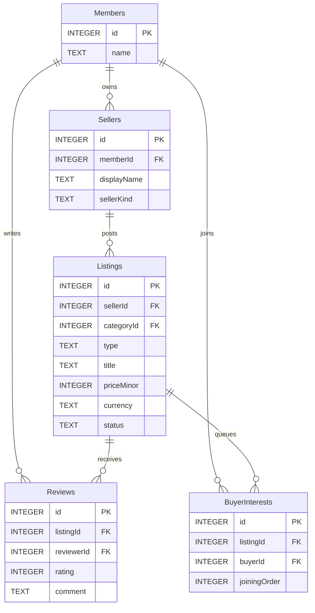
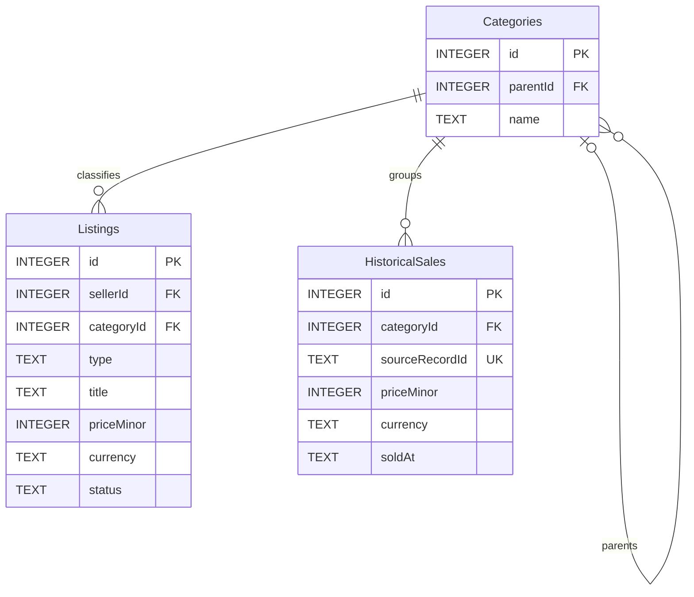
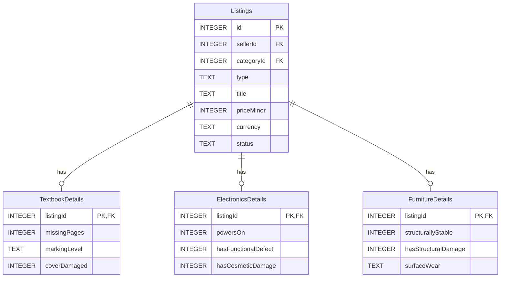

# UC-B Campus Marketplace with Reviews

Project Design Document

CPE 314 - Software Design

University of Cebu

Computer Engineering Department

**Group Name / No.:** Group 1 / Team 01 - BSCPE 3B - EDP 69323

**Members:**

John Benedict Alaiza

Acexion B. Mahigugmaon

Glyde V. Arreglado

Tristan Dominic Urot

Joshua Brian S. Enovero

Emanuelle De Paz

**Instructor:** Richyll Son

**Term:** First Semester, S.Y. 2026-2027

**Document Version / Date:** V 0.3 / 7 November 2026

**Repository:** [XionAce/cpe314-69323-capstone-team-01](https://github.com/XionAce/cpe314-69323-capstone-team-01)

<!-- pagebreak -->

## Table of Contents

<!-- toc -->

<!-- pagebreak -->

## Revision History

Table 1: Document revisions

| Version | Date | Author | Changes |
|---|---|---|---|
| 0.1 | 23 Oct 2026 | Group 1 | Initial Week 8 overview, ER sketch and responsibilities. |
| 0.2 | 25 Oct 2026 | Group 1 | Week 9 classes, GUI and database design. |
| 0.3 | 5 Nov 2026 | Group 1 | Week 10 API, background JSON import and category charts. |
| 0.3 | 7 Nov 2026 | XionAce | Instructor corrections: one Markdown master, complete ERD attributes, SQL statements, clearer setup and recovery for missing condition details. |

<!-- pagebreak -->

## 1. Introduction & Project Overview

UC-B Campus Marketplace with Reviews is a local Java desktop app for students, faculty and school groups to post and browse campus goods. Its theme is Campus Marketplace with Reviews (Option J). Textbook, Electronics and Furniture listings use different condition rules. Members can search categories, join waitlists, leave reviews and view category summaries.

The prototype uses JavaFX, SQLite/JDBC and JSON sales-history files. Fictional demo members can both browse and sell; real login, online payments and a cloud server are outside its scope. The proposal was approved after the Week 8 revision.

## 2. Preliminary ER Sketch & Team Roles

The proposal model links members, sellers, categories, listings and reviews. One seller can post many listings, and one listing can receive many reviews. Section 4 replaces the preliminary sketch with the complete implemented ERD, including all ten tables and their attributes.

The proposal and this document now show the same full diagrams to address the instructor's ERD feedback. PK identifies a row, FK points to a related row, and UK marks a unique value. A root category has no parent; other categories have one parent.

Table 2: Team responsibilities

| Member and role | Responsibility |
|---|---|
| John Benedict Alaiza - Backend Developer (Listing Models) | Listing classes, condition rules and validation. |
| Acexion B. Mahigugmaon - Project Leader / Integration | Connect the components, maintain documents and coordinate fixes. |
| Glyde V. Arreglado - Database Admin | SQLite tables, saved records and summary queries. |
| Tristan Dominic Urot - UI/GUI Developer | JavaFX controls, event handlers and charts. |
| Joshua Brian S. Enovero - Backend & API Developer | Catalog requests, JSON parsing and import. |
| Emanuelle De Paz - QA & Testing | Test cases, expected calculations and error checks. |

<!-- pagebreak -->

## 3. System Architecture & Object-Oriented Design

Models hold item rules, MarketplaceService coordinates actions, Database handles SQL, and MarketplaceView handles the JavaFX screen. App connects these parts when the program starts.

```text
Listing (abstract)
  Textbook extends Listing
  Electronics extends Listing
  Furniture extends Listing
```

The shared Listing fields are ID, seller/category IDs, title, price, currency and status. The abstract methods getType() and gradeCondition() are implemented by each subclass. A List<Listing> can hold all three types. Calling gradeCondition() through Listing runs the actual object's method; this is runtime polymorphism.

Table 3: Model responsibilities and Single Responsibility Principle

| Class | Responsibility and reason to change |
|---|---|
| Listing | Shared listing values and validation. Changes when common listing rules change. |
| Textbook | Textbook evidence and condition grade. Changes when textbook condition rules change. |
| Electronics | Electronics evidence and condition grade. Changes when electronics condition rules change. |
| Furniture | Furniture evidence and condition grade. Changes when furniture condition rules change. |
| ConditionGrade / WearLevel | Allowed grade and wear values. Changes when these allowed values change. |
| Member / Category | Member identity and category parent data. Changes when these records change. |

Keeping item rules separate from SQL and controls follows the Single Responsibility Principle. A changed grading rule belongs in its item class.

### Condition rules

- Textbook: missing pages = POOR; heavy markings = FAIR; light markings or cover damage = GOOD; otherwise LIKE_NEW.
- Electronics: no power or a functional defect = POOR; cosmetic damage = GOOD; otherwise LIKE_NEW.
- Furniture: unstable or structurally damaged = POOR; heavy wear = FAIR; light wear = GOOD; otherwise LIKE_NEW.

<!-- pagebreak -->

### Supporting components

Table 4: Supporting responsibilities

| Component | Responsibility and reason to change |
|---|---|
| App | Starts and connects the app; changes when startup setup changes. |
| MarketplaceView | Controls and event handlers; changes when the screen workflow changes. |
| MarketplaceService | Coordinates use cases, category search, waitlists and recent views; changes when app rules change. |
| Database | Schema setup, saved records and SQL summaries; changes when persistence changes. |
| ProductCatalogClient / CatalogProduct | Catalog HTTP/parsing and returned product values; changes when the API contract changes. |
| SalesHistoryImporter | Validates and imports sales JSON; changes when import rules change. |

### Collections and recursion

Waitlists use Queue with ArrayDeque: offer() adds at the tail and poll() reads the first buyer. Stored joiningOrder values rebuild FIFO order. A Map stores each member's Stack of recently viewed IDs. push() adds the latest view; pop() reads a copy, preserving session history. At most 20 unique views are kept per member.

collectCategoryIds() adds a category ID and recursively visits each child. A category without children is the base case. Validation rejects missing parents, duplicate IDs and cycles before traversal. Search includes the selected category and all descendants.

### GUI workflow and recovery

Marketplace supports posting, searching, viewing, waitlists, reviews and API suggestions. Sales history imports JSON. Analytics shows price and rating charts.

The current busy flag rejects another task while one runs, and action buttons are disabled until it finishes. Members and categories load before the listing search, so a damaged listing cannot block access to recovery controls.

If a listing has no condition-detail row, search reports its ID. Its owner can choose Restore missing details, select the item and explicitly select its observed condition. The saved listing, reviews and waitlist remain. Existing or conflicting details cannot be overwritten through this action; conflicting rows require database-maintainer review. Demo-member selection is not real authentication.

<!-- pagebreak -->

## 4. Data Model & Database Design

The schema defines ten application tables. The ERD is split into three views for readability; Listings is repeated to connect the views. Every table attribute is included. TEXT and INTEGER are SQLite types. The schema below specifies nullability and checks.



Figure 1: Members, sellers, listings, reviews and buyer interests

<!-- pagebreak -->

### Categories and historical sales



Figure 2: Categories, current listings and imported historical sales

A root category has NULL parentId. A non-root category has one parent, and a parent can have zero or more children. HistoricalSales contains imported past sales, not new marketplace listings. sourceRecordId prevents duplicate imports.

<!-- pagebreak -->

### Listing condition details



Figure 3: Shared listing fields and type-specific condition evidence

Each listing has exactly one matching detail row overall. It has zero or one row in each individual detail table, depending on type. A detail row's listingId is both its primary key and its foreign key. The app saves the listing and detail row in one transaction, and checks the type when reading. Foreign keys alone do not guarantee exactly one matching subtype.

<!-- pagebreak -->

### Relationships and storage rules

Table 5: Relationship cardinalities

| Parent | Child | Relationship |
|---|---|---|
| Members | Sellers | 1 to 0..* |
| Members | Reviews | 1 to 0..* |
| Members | BuyerInterests | 1 to 0..* |
| Sellers | Listings | 1 to 0..* |
| Categories | Listings | 1 to 0..* |
| Categories | HistoricalSales | 1 to 0..* |
| Categories | Categories | 0..1 parent to 0..* children |
| Listings | Reviews | 1 to 0..* |
| Listings | BuyerInterests | 1 to 0..* |
| Listings | Each detail table | 1 to 0..1; exactly one matching subtype overall |

Prices use integer minor units: PHP 350.50 is stored as priceMinor 35050 and currency PHP. Java uses BigDecimal. The app uses AVAILABLE and WITHDRAWN status values. Required names are nonblank; review ratings range from 1 to 5. Java prevents self-review and repeat reviews through the app's serialized transaction path.

Foreign keys are enabled on every SQLite connection. PreparedStatement binds input values to SQL. Each operation opens its own connection. Listing/detail insertion and detail restoration use transactions and roll back on failure.

The following CREATE TABLE statements match [schema.sql](../program/src/main/resources/db/schema.sql). Each snippet defines one table. Index statements remain in the linked schema file.

### Members

```sql
CREATE TABLE Members (
    id INTEGER PRIMARY KEY,
    name TEXT NOT NULL CHECK (length(trim(name)) > 0)
);
```

### Sellers

```sql
CREATE TABLE Sellers (
    id INTEGER PRIMARY KEY,
    memberId INTEGER NOT NULL REFERENCES Members(id),
    displayName TEXT NOT NULL CHECK (length(trim(displayName)) > 0),
    sellerKind TEXT NOT NULL CHECK (length(trim(sellerKind)) > 0)
);
```

### Categories

```sql
CREATE TABLE Categories (
    id INTEGER PRIMARY KEY,
    parentId INTEGER REFERENCES Categories(id),
    name TEXT NOT NULL CHECK (length(trim(name)) > 0),
    CHECK (parentId IS NULL OR parentId <> id)
);
```

### Listings

```sql
CREATE TABLE Listings (
    id INTEGER PRIMARY KEY,
    sellerId INTEGER NOT NULL REFERENCES Sellers(id),
    categoryId INTEGER NOT NULL REFERENCES Categories(id),
    type TEXT NOT NULL CHECK (type IN ('TEXTBOOK', 'ELECTRONICS', 'FURNITURE')),
    title TEXT NOT NULL CHECK (length(trim(title)) > 0),
    priceMinor INTEGER NOT NULL
        CHECK (typeof(priceMinor) = 'integer' AND priceMinor > 0),
    currency TEXT NOT NULL
        CHECK (length(currency) = 3 AND currency NOT GLOB '*[^A-Z]*'),
    status TEXT NOT NULL CHECK (length(trim(status)) > 0)
);
```

### Reviews

```sql
CREATE TABLE Reviews (
    id INTEGER PRIMARY KEY,
    listingId INTEGER NOT NULL REFERENCES Listings(id),
    reviewerId INTEGER NOT NULL REFERENCES Members(id),
    rating INTEGER NOT NULL
        CHECK (typeof(rating) = 'integer' AND rating BETWEEN 1 AND 5),
    comment TEXT
);
```

### BuyerInterests

```sql
CREATE TABLE BuyerInterests (
    id INTEGER PRIMARY KEY,
    listingId INTEGER NOT NULL REFERENCES Listings(id),
    buyerId INTEGER NOT NULL REFERENCES Members(id),
    joiningOrder INTEGER NOT NULL
        CHECK (typeof(joiningOrder) = 'integer' AND joiningOrder > 0),
    UNIQUE (listingId, buyerId),
    UNIQUE (listingId, joiningOrder)
);
```

### HistoricalSales

```sql
CREATE TABLE HistoricalSales (
    id INTEGER PRIMARY KEY,
    categoryId INTEGER NOT NULL REFERENCES Categories(id),
    sourceRecordId TEXT NOT NULL UNIQUE
        CHECK (length(trim(sourceRecordId)) > 0),
    priceMinor INTEGER NOT NULL
        CHECK (typeof(priceMinor) = 'integer' AND priceMinor > 0),
    currency TEXT NOT NULL
        CHECK (length(currency) = 3 AND currency NOT GLOB '*[^A-Z]*'),
    soldAt TEXT NOT NULL CHECK (length(trim(soldAt)) > 0)
);
```

### TextbookDetails

```sql
CREATE TABLE TextbookDetails (
    listingId INTEGER PRIMARY KEY REFERENCES Listings(id) ON DELETE CASCADE,
    missingPages INTEGER NOT NULL
        CHECK (typeof(missingPages) = 'integer' AND missingPages >= 0),
    markingLevel TEXT NOT NULL CHECK (markingLevel IN ('NONE', 'LIGHT', 'HEAVY')),
    coverDamaged INTEGER NOT NULL
        CHECK (typeof(coverDamaged) = 'integer' AND coverDamaged IN (0, 1))
);
```

### ElectronicsDetails

```sql
CREATE TABLE ElectronicsDetails (
    listingId INTEGER PRIMARY KEY REFERENCES Listings(id) ON DELETE CASCADE,
    powersOn INTEGER NOT NULL
        CHECK (typeof(powersOn) = 'integer' AND powersOn IN (0, 1)),
    hasFunctionalDefect INTEGER NOT NULL
        CHECK (typeof(hasFunctionalDefect) = 'integer' AND hasFunctionalDefect IN
        (0, 1)),
    hasCosmeticDamage INTEGER NOT NULL
        CHECK (typeof(hasCosmeticDamage) = 'integer' AND hasCosmeticDamage IN (0,
        1))
);
```

### FurnitureDetails

```sql
CREATE TABLE FurnitureDetails (
    listingId INTEGER PRIMARY KEY REFERENCES Listings(id) ON DELETE CASCADE,
    structurallyStable INTEGER NOT NULL
        CHECK (typeof(structurallyStable) = 'integer' AND structurallyStable IN (0,
        1)),
    hasStructuralDamage INTEGER NOT NULL
        CHECK (typeof(hasStructuralDamage) = 'integer' AND hasStructuralDamage IN
        (0, 1)),
    surfaceWear TEXT NOT NULL CHECK (surfaceWear IN ('NONE', 'LIGHT', 'HEAVY'))
);
```

<!-- pagebreak -->

## 5. API Integration Design

The app consumes FakeStoreAPI to suggest an electronics category and show comparable catalog prices. Clicking Suggest category / price makes a fresh GET request to https://fakestoreapi.com/products. No API key is required.

Example response shape (illustrative values):

```json
[
  {
    "id": 1, "title": "Example monitor", "price": 120.50,
    "category": "electronics", "description": "Product details",
    "image": "https://example.com/product.png",
    "rating": {"rate": 4.2, "count": 25}
  }
]
```

ProductCatalogClient uses Java HttpClient with a 15-second timeout. It checks HTTP 200, parses the JSON with Gson and validates product values. CatalogProduct holds id, title, category and BigDecimal price. Other response fields are not used by this feature.

MarketplaceView calls ProductCatalogClient.matches(), which compares meaningful title words with electronics product titles, ranks matches and returns up to three. The screen selects the local Electronics category and shows the lowest and highest reference prices. The member may choose a child category and enters the final PHP price manually.

The API does not identify the price currency. The app labels the range as a catalog reference with unspecified currency and never silently converts it to PHP. Textbook/furniture or unmatched queries retain manual entry. A timeout, failed status or invalid JSON displays a retry/manual-entry message. A form changed during the request does not receive a stale suggestion. The screen shows request time and HTTP status.

<!-- pagebreak -->

## 6. Concurrency Design

HTTP requests, large JSON imports and database summaries run on a background worker. MarketplaceView.runTask() creates a JavaFX Task; one ExecutorService executes it. JavaFX reads form values before starting the task. Success and failure callbacks update controls on the JavaFX thread. Platform.runLater() delivers import progress to that thread.

### Background JSON import

SalesHistoryImporter streams a UTF-8 JSON array one row at a time. Each record contains sourceRecordId, categoryPath, price, currency and soldAt. Validation checks required values, an existing unique category path, a positive price with exact minor units, an uppercase currency and a timestamp with timezone.

Valid rows go into HistoricalSales. Duplicate source IDs and invalid field values are skipped and counted. One transaction commits the new rows only after the file is read successfully. Broken JSON, database failure or cancellation rolls back the new rows from that import. Existing saved sales remain.

### Responsiveness and cancellation

The busy flag rejects overlapping operations. Only work buttons are disabled; tabs, loaded table selection/scrolling, form fields and About remain usable. The import panel displays progress and provides Cancel import. Cancel sets a flag checked between records, and the importer rolls back when it notices the flag. Final saved/invalid/duplicate counts appear after successful completion.

Each database operation owns its connection. Closing the app requests cancellation and shuts down the executor. A short three-record sample finishes quickly; the supplied large fictional JSON generator supports the responsiveness demonstration.

<!-- pagebreak -->

## 7. Data Mining & Visualization Design

The app summarizes saved marketplace data by category and displays counts alongside averages. The results help a member compare listing prices and campus review ratings.

Table 6: Category calculations

| Result | Calculation and data |
|---|---|
| Average listing price | AVAILABLE Listings in the selected currency, grouped by category: AVG(priceMinor) / 100.0; COUNT(*) gives listing count. |
| Average review rating | Reviews joined to AVAILABLE Listings, grouped by category: AVG(rating); COUNT(*) gives review count. Highest average identifies the best-rated category; ties are shown. |

Separate queries prevent multiple reviews from counting the same listing price repeatedly. Different currencies remain separate. Imported HistoricalSales and external API prices/ratings are excluded from these two calculations. A category without campus reviews is unrated, not zero stars.

### Charts and why they fit

Two JavaFX bar charts compare category averages. Each bar represents one category, so bar height makes differences easy to see.

- Average listing price by category: X-axis Category; Y-axis Price in the selected currency, initially PHP.
- Average review rating by category: X-axis Category; Y-axis Rating, on a 0-5 scale.

Both charts have titles and axis labels. Each uses one series, so a legend is unnecessary. Refresh analytics reads current database summaries. Empty results show a no-data title; the screen reports the best-rated category with its review count.

Example: PHP 100 and PHP 200 average PHP 150. Adding PHP 300 makes the average PHP 200. Review ratings 4 and 5 average 4.5. The app calculates these values from saved rows.

<!-- pagebreak -->

## Appendix - References and reproduction

The editable master is docs/design-document.md. docs/design-document.pdf is its exported copy. Edit the Markdown first, then run docs/export_documents.py with Python, ReportLab and Calibri fonts. Exported PDF text, tables, SQL and ERD fields come from this master.

Use JDK 21 for the Java project and Maven launch. The enforcer range [21,22) intentionally rejects JDK 17 and 25. From program/, run `java -version`, `./mvnw.cmd -version`, then `./mvnw.cmd clean verify`. Both version checks must show Java 21; do not skip the enforcer to claim a normal build. The existing Eclipse Java Application and Antigravity Run profiles remain available.

- [Team repository](https://github.com/XionAce/cpe314-69323-capstone-team-01)
- [Project proposal](proposal.md)
- [Build and demonstration guide](MILESTONE_2.md)
- [FakeStoreAPI documentation](https://fakestoreapi.com/docs)
- [Project Design Document Template](https://drive.google.com/file/d/1sRJ5rjciHBeYgBQmUbpJB12kWyD_sCkO/view)
- [Week 10 Project Design Document Checklist](https://drive.google.com/file/d/1QG1zJGib8TXtcc-Ur_awPQRklWvUheQa/view)
