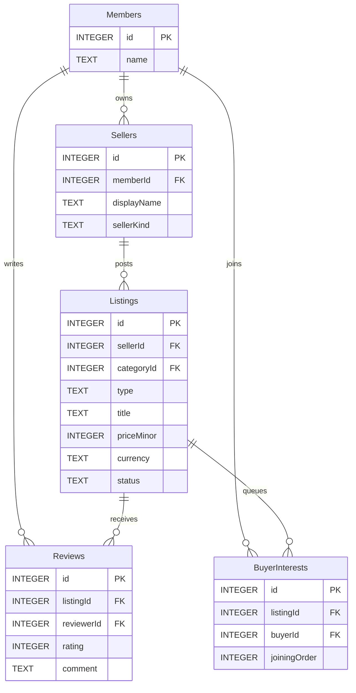
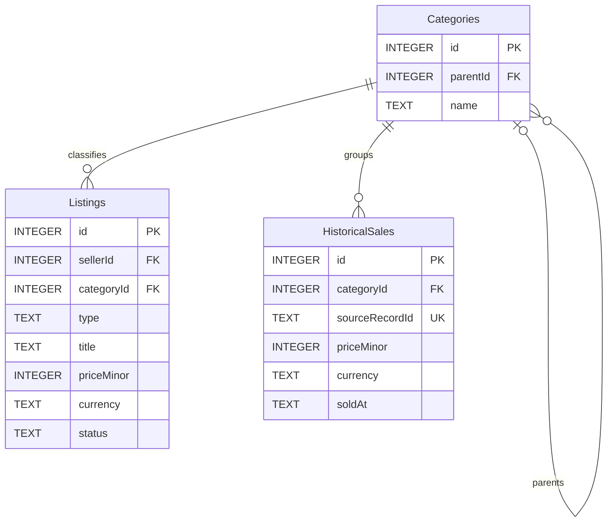
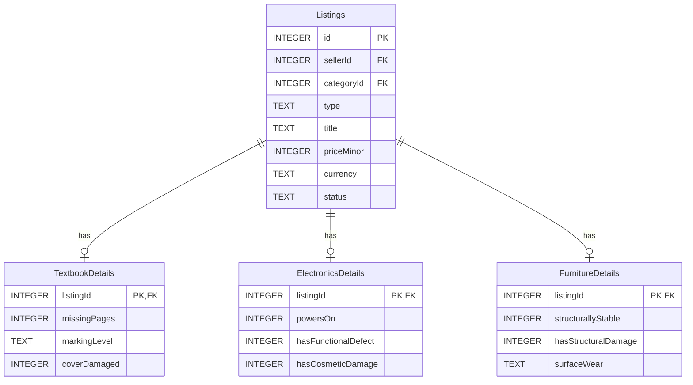

# UC-B Campus Marketplace with Reviews

Week 8 - Project Proposal (approved; corrected 7 November 2026)

CPE 314 - Software Design

**Group Name / No.:** Group 1 / Team 01 - BSCPE 3B - EDP 69323

**Members:**

John Benedict Alaiza

Acexion B. Mahigugmaon

Glyde V. Arreglado

Tristan Dominic Urot

Joshua Brian S. Enovero

Emanuelle De Paz

**Repository:** [XionAce/cpe314-69323-capstone-team-01](https://github.com/XionAce/cpe314-69323-capstone-team-01)

**Theme:** Campus Marketplace with Reviews

**API:** FakeStoreAPI - https://fakestoreapi.com

**Version:** V 0.2 - instructor corrections, 7 November 2026

## 1. One-Paragraph Pitch

UC-B Campus Marketplace with Reviews is a local Java desktop app for students, faculty and school groups to post and browse campus goods. Textbook, Electronics and Furniture listings have their own condition rules. Recursive category search, buyer-interest queues, recently viewed stacks, reviews, SQLite/JDBC persistence, public API suggestions, background JSON sales-history import and category charts demonstrate the required lessons. The prototype uses demo members; real login and online payments are outside its scope. The proposal was approved after the Week 8 revision.

<!-- pagebreak -->

## 2. Entity-Relationship Sketch

The revised ERD shows all ten application tables and all their attributes. Listings is repeated across three views to keep the diagram readable. PK = primary key, FK = foreign key, UK = unique key. Complete SQL and constraints are in Section 4 of the project design document.

Figure 1: Members, sellers, listings, reviews and buyer interests

<!-- pagebreak -->

### Categories and imported sales

Figure 2: Categories, listings and historical sales

Each category has zero or one parent and zero or more children. Current listings and historical sales each belong to one category.

<!-- pagebreak -->

### Condition details

Figure 3: Type-specific listing details

Each listing has exactly one matching subtype-details row overall. listingId is both the PK and FK in each detail table. Transactions and Java validation enforce the matching-type rule.

<!-- pagebreak -->

## 3. Feature Checklist

Table 1: Features and course requirements

| Feature | Requirement |
|---|---|
| Abstract Listing with three condition-grading subclasses | Object-oriented design and polymorphism |
| FIFO waitlist, LIFO recent history and recursive category search | Data structures and recursion |
| JUnit normal and edge-case checks | Automated testing |
| Related SQLite tables and PreparedStatement persistence | Database modeling and JDBC |
| Live FakeStoreAPI catalog suggestions | API consumption |
| JavaFX controls and background JSON/API operations | Event-driven GUI and concurrency |
| Category means, counts and labeled bar charts | Data mining and visualization |

## 4. Task Split

Table 2: Team responsibilities

| Member and role | Responsibility |
|---|---|
| John Benedict Alaiza - Backend Developer (Listing Models) | Listing classes, condition rules and validation. |
| Acexion B. Mahigugmaon - Project Leader / Integration | Connect the components, maintain documents and coordinate fixes. |
| Glyde V. Arreglado - Database Admin | SQLite tables, saved records and summary queries. |
| Tristan Dominic Urot - UI/GUI Developer | JavaFX controls, event handlers and charts. |
| Joshua Brian S. Enovero - Backend & API Developer | Catalog requests, JSON parsing and import. |
| Emanuelle De Paz - QA & Testing | Test cases, expected calculations and error checks. |

<!-- pagebreak -->

## 5. Public API

FakeStoreAPI GET https://fakestoreapi.com/products returns product JSON without an API key. Electronics title matching supplies category and catalog reference-price suggestions. API currency is unspecified; the member enters the final PHP price. Unsupported or unmatched items keep manual entry available. See [API documentation](https://fakestoreapi.com/docs).

## 6. Risks / Open Questions

1. If FakeStoreAPI matches a new electronics product but gives no currency, how will we prevent a misleading PHP resale-price suggestion?

2. If a listing has several campus reviews, how will we stop its price from being counted several times in the category price average?

3. If the same sales JSON file is imported twice, or cancellation occurs after some rows are processed, how will HistoricalSales avoid duplicate or partially saved sales?

4. If a Listings row loses its TextbookDetails, ElectronicsDetails or FurnitureDetails record, how will its owner restore the actual condition without replacing the listing or its reviews?
